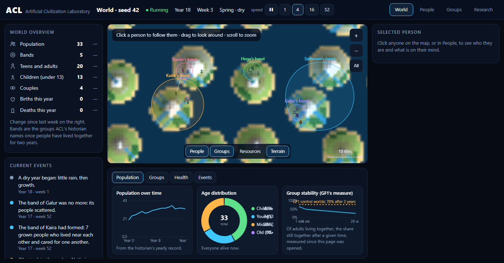

# Artificial Civilization Laboratory

**Twenty people wake up on a set of islands knowing nothing. No tools, no fire, no language, no rules. Nobody writes
their history. What do they build?**

[](pyproject.toml)
[](pyproject.toml)
[](https://github.com/abu4evere/simulated-world/actions/workflows/tests.yml)
[](https://www.amazon.com/s?k=The+World+That+Nobody+Wrote+Khudoyberdiev)



ACL is a simulated world of hunter-gatherers where **nature is programmed and culture is not**. People have bodies,
hunger, cold, fear, love, grief, curiosity and memory. Stone can be struck, wood floats, seeds grow. That is all. No
list of inventions, no reward for being clever, no script. Whatever they come to make, believe or pass on, they find for
themselves, or it never exists.

Then I measure what happens, with the rigour of a lab: every experiment's predictions are written down and locked
before it runs, every world replays bit for bit, and every wrong guess stays in the record.

## What happened in their worlds

- **They invented a raft in their first weeks, and never used it.** Nothing ever showed them what floating was for.
- **One person made the only water vessel in their world, and carried it beside fresh water for two years without
  once filling it.** The thirsty people never had one.
- **A killing was remembered for 180 years, across five generations, and blamed on the wrong person.**
- **Two peoples lived side by side for a thousand years and never met.** Each grew its own marks, crafts and beliefs.
- **Food flows to family:** 72% of gifts go to relatives, and a third of all gifts to brothers and sisters. Nobody wrote that.
- **And culture keeps stalling.** Nine in ten useful inventions are never passed on, and 99% of those are forgotten
  within a season, pushed out of memory before anyone could learn them. Finding out why is what this project does.

| question | answer | record |
|---|---|---|
| Why do a third of small worlds die out? | Not hunger: **people can't find partners.** With perfect partner-finding, 17 of 22 doomed worlds survive. | [F1](experiments/F1_baseline_fragility/findings.md), [F2](experiments/F2_perfect_search/findings.md) |
| Does more land help, or more people? | **People.** 80 founders instead of 20: extinction falls from 2 worlds in 5 to under 1 in 100. | [WS1](experiments/WS1_world_size/findings.md) |
| What decides whether a small world survives? | **How far people can see.** Halve sight: 49 of 64 worlds die; double it: 8. | [SA1](experiments/SA1_sensitivity/findings.md) |
| Where does cumulative culture break? | **At the first hand-over.** About 1 useful invention in 10 is ever learned by anyone else. | [CA1](experiments/CA1_chain_audit/findings.md), [CA2](experiments/CA2_teaching_gates/findings.md), [CA3](experiments/CA3_opportunity/findings.md) |

All 76 studies, with their predictions and results: [`experiments/INDEX.md`](experiments/INDEX.md).

## Read the story

**[*The World That Nobody Wrote, Part One*](https://www.amazon.com/s?k=The+World+That+Nobody+Wrote+Khudoyberdiev)** (Kindle and paperback, on Amazon): how the worlds
were built, what their people did, and every mistake along the way.

## Run a world yourself

```bash
git clone https://github.com/abu4evere/simulated-world.git
cd simulated-world
python -m acl watch
```

Pure Python, no dependencies. A world opens in your browser: click anyone to follow them and see what is on their mind.

## How it stays honest

- **Predictions first.** Each experiment's plan and guesses are committed and git-tagged before any code or data.
- **Controls and replication.** Changes are compared on identical worlds, with "sham" worlds to show what chance alone
  does, and findings are re-checked on worlds nobody has looked at.
- **Measurement never touches the world.** Every observer is proven read-only: the world ends identical with and without it.
- **No hidden answers.** A test fails if invention names appear in the code people think with.
- **Failures are kept.** Wrong predictions are printed as wrong; corrections are added beside the original, never over it.
- **Check one end to end:** [LK1](experiments/LK1_location_knowledge/): frozen plan
  ([`questions.md`](experiments/LK1_location_knowledge/questions.md), tag `LK1-frozen`) → runner → raw outputs →
  [`results.md`](experiments/LK1_location_knowledge/results.md) → [`findings.md`](experiments/LK1_location_knowledge/findings.md).

---

**Human nature built in, culture left to emerge.** An agent-based simulation
of a small prehistoric people on a set of islands. Bodies, feelings, memory,
weather, animals and the physics of materials are programmed; tools, fire,
shelter, myths, symbols, trust and feuds are not. Whatever culture appears is
discovered by the people themselves, passed on by teaching and talk, and lost
when nobody remembers it. A read-only historian names what happened, and
pre-registered experiments ([`experiments/`](experiments/)) measure how far
it gets.

A small world you can watch but not control. Twenty people start out knowing
nothing: no tools, no fire, no farming, no rules. Everything after that is up
to them.

## Their world, always on

Their world lives on its own clock: **fifteen real minutes is one day for them**.
A week passes every hour and three quarters, a year about every four days, and
a generation about every three months. It keeps going whether or not anyone is
watching. The people know nothing of hours, weeks or years; those are only
shown to you.

| To | Do this |
|---|---|
| start it in the background, with no window | double-click `start_world.bat` |
| look in | double-click `watch_world.bat`, or open http://127.0.0.1:8765/ |
| stop it | double-click `stop_world.bat` (it saves first) |

What you see:
- **The land.** Trees, berry bushes, rocks and deer change with the seasons:
  blossom in spring, red leaves in autumn, snow in winter.
- **Days and nights.** Each of their days is fifteen minutes here. People wake
  at dawn, walk out to the week's work, come home at dusk and sleep around the
  fire.
- **People.** Each one has arms and legs, hair and clothes in their family's
  colour. They pick berries, chop wood, strike stones (with sparks), hunt
  deer with spears, carry babies on their backs, sit by fires, court and fight.
- **Conversations.** Whoever spent the week with someone (talking, courting,
  caring, giving food) stays with them through the day, and the two talk back
  and forth. What they say comes from what really passed between them in the
  simulation:
  - news ("Did you hear? Ka killed Mo!");
  - a skill taught ("Watch: strike flint with stone");
  - thanks for food, or a cry of "Thief!".

  The listener answers from their own feelings: "No... not Mo!" if they loved
  Mo, "We have to watch out for Ka" if they didn't. Bold speech carries real
  news or knowledge; lighter speech is everyday talk. The side panel lists
  every line as it is said.
- **Evenings.** By the fire, couples talk over the day. Parents tell their
  children stories taken from their own memories ("I remember when Neishoul
  died. I still miss them."). That is how old events reach the young.
- **What they make.** Huts, fires, baskets, sown rows and spears appear as the
  people work them out.
- **Real weather.** Rain, snow, storms (a dark patch over the land) and floods
  on the river banks are drawn when they really happen in their world.
- **Marks.** Scratches people leave on rock, wood or the ground, drawn where
  they are. They mean nothing unless the people come to link them with
  something.
- **Their clock.** The panel shows their time of day (for example
  `06:42 · morning`), the day of their week, the season and the year. Only you
  see it; they have no clock.

Scroll to zoom in and drag to look around. Click anyone to follow them; the
camera stays with them, and the side panel shows their family, what they
remember, what they know how to make, what they have come to believe, and
**what is on their mind**:
- the thoughts pulling at them this week, strongest first, and whether they
  are focused or overthinking;
- the choices they weighed and the one they took;
- what puzzles them, and how many times they have gone back to test it;
- what they were told but have not tried yet, and who told them;
- the marks they know, and what each has come to go with for them;
- their feelings: mood, fear, anger, grief, loneliness, thirst.
Nothing on the page can change their world.

The world is kept in `world/`:
- It saves after every week.
- If the computer is off for a while, it catches up on the weeks it missed
  when it starts again, so their time never stands still.
- `world/chronicle.md` is everything that has happened so far.
- `python -m acl live --new` begins a new world. The old one is moved to
  `world/old/`, never deleted.

### Putting it online so it never stops

`Dockerfile` and `fly.toml` run the same world on a server that never sleeps,
at about $2 a month on Fly.io. Online, the page is watch-only, and nothing
outside the server can stop or speed up the world.

## Trying things out

```bash
python -m acl watch
```

That opens a separate, throwaway world at whatever speed you like. Your
people's world is not touched.

## What is built in, and what is not

**Built in, as nature:**
- **Bodies:** hunger, cold, sickness, ageing, birth and death.
- **Feelings:** love for one's children, grief, anger, fear, loneliness, and
  grudges against people who hurt you or yours.
- **Memory**, and the urge to tell others what happened.
- **Learning:** trying things, noticing what worked, and copying people who
  seem to do well.
- **Physics:** what stone, flint, bone, wood, fiber and hide are like, what
  happens when you strike one against another or tie them together, how fire
  burns, and how seed grows in the ground.

**Not built in, and left for them:**
- tools and weapons;
- making fire, and keeping it;
- shelter and dwellings;
- sowing seed, and storing food;
- trade, leaders, bands and settlements;
- revenge customs and feuds.

Nothing the people think with contains a list of inventions. Nobody is told
that flint struck with stone leaves a sharp edge, or that hides and wood piled up keep the
winter out. If someone finds out, it is because they fiddled with things and
noticed what helped. They teach what they found to their children, or it dies
with them.

The [historian](acl/historian.py) watches and gives names afterwards: "the
first blade", "the first fire made by people", "the first dwelling", "a feud".
It judges inventions only by what they can do (edge, reach, hardness, how they
hold and how they warm). It never influences anyone, and a test checks that.

All the rules and numbers are in [DESIGN.md](DESIGN.md).

## A run, in its own words

From seed 42. These lines are copied from the chronicle the historian wrote:

> **Year 1** Veleiko struck flint with flint and was left with a sharp edge: the first blade.
> **Year 5** Naber tied a blade and wood together with fiber and was left with a sharp point on a long shaft: the first spear.
> **Year 7** Thoulailis struck flint where dry things lay, and they caught: the first fire made by people.
> **Year 10** Mutuden took in the orphan Saikei, no relation, the first time a stranger raised another's child.
> **Year 11** At (12, 5) the heap of things people had left grew big enough to keep out a fifth of the winter cold: the first dwelling. Veleiko had put in the most.

## Commands

```bash
python -m acl live
```
Their world, on its own clock. `--hours-per-day` changes the pace, and `--new` begins a new world.

```bash
python -m acl stop
```
Stop it, saving first.

```bash
python -m acl watch --seed 42
```
A throwaway world at any speed. `--speed` sets weeks per second, and `--out DIR` saves a report of what you watched when you stop.

```bash
python -m acl run --seed 42 --years 100
```
Run without watching. Writes a report, chronicle, event log and snapshots to `runs/seed42/`.

```bash
python -m acl resume runs/seed42/final.json.gz --years 50
```
Carry on from a snapshot.

```bash
python -m acl check --seeds 1-10 --years 100
```
Score the success criteria across many seeds.

```bash
python -m acl replay --seed 42 --years 40
```
Prove the same seed always gives the same history, whether run straight through or resumed from a snapshot.

```bash
python -m pytest
```
Run the tests.

It needs Python 3.10 or newer and nothing else. No packages and no network.
A 100-year run takes about a minute.

## What a run writes

| File | What it is |
|---|---|
| `report.html` | Charts (population, who can make what, what people believe, dwellings, fields, fires, stores), the final map, the chronicle |
| `chronicle.md` | The history the historian wrote |
| `history.json` | Yearly statistics, bands, settlements, feuds, oral history |
| `metrics.json` | The numbers the success criteria use |
| `events.jsonl.gz` | Every event, one per line |
| `snapshot_y*.json.gz`, `final.json.gz` | Full saved worlds you can resume |

## Success criteria for this first version

The `check` command scores each seed on six criteria:
1. People are still alive after 100 years.
2. The population grew past the founders.
3. At least 3 generations were born.
4. At least half of children reached 16.
5. People lead varied lives (normalised action entropy ≥ 0.5).
6. At least 5 of these 8 unprogrammed patterns appeared:
   - exchange between unrelated people;
   - bands;
   - revenge;
   - settlements;
   - a made thing that 30% of people know;
   - fire made by hand;
   - dwellings;
   - sowing or storing food on purpose.

These are health checks, not targets. Passing on one seed proves little, which
is why `check` runs many.

## Project layout

| File | Contents |
|---|---|
| `acl/config.py` | Every number |
| `acl/matter.py` | Materials, striking, tying, what things do, heaps |
| `acl/world.py` | Land, seasons, weather, seeds, fire, the weekly loop, saving |
| `acl/person.py` | A person |
| `acl/mind.py` | How a person decides |
| `acl/actions.py` | What happens when they act |
| `acl/knowhow.py` | What people work out, and how it passes on |
| `acl/social.py` | Memories, witnesses, grudges |
| `acl/information.py` | Telling and believing: imperfect retelling, the listener's judgement, hearsay |
| `acl/inquiry.py` | Surprise, puzzles and going back to test |
| `acl/marks.py` | Marks, and what people come to link them with |
| `acl/thought.py` | Attention: what is on someone's mind, focus, overthinking |
| `acl/mindview.py` | What is on someone's mind, in words, for the page |
| `acl/geo.py` | The islands, rivers, lakes and kinds of land |
| `acl/fauna.py` | Animals and the food chain |
| `acl/weather.py` | Rain, droughts, storms, floods, cold, water and thirst |
| `acl/decision.py`, `acl/experiment.py` | Experiment 0: the decision interface and its read-only logs |
| `acl/biology.py` | Eating, cold, sickness, birth, death, feelings, learning |
| `acl/historian.py` | The read-only historian |
| `acl/viewer.py`, `acl/viewer.html` | The live 2D world, its clock, saving and catching up |
| `start_world.bat`, `watch_world.bat`, `stop_world.bat` | One-click start, look in, stop on Windows |
| `Dockerfile`, `fly.toml` | Running it online |
| `acl/report.py` | The HTML report |
| `acl/runner.py`, `acl/checks.py`, `acl/__main__.py` | Running, checking, the command line |

## Related work

ACL belongs to a long line of artificial worlds, and differs from most of them in two ways.

**What accumulates, and how.** In most open-ended simulations, behaviour improves through evolution: agents whose
networks work better leave more offspring, and pass those networks on. In ACL, nothing is inherited but the body.
What a person knows, they learned in their own lifetime, from experience, from watching or from stories, and it dies
with them unless someone else learns it.

**How claims are made.** Every experiment freezes its predictions before any code, compares against a control on the
same worlds, checks that measurement never touches the world, and tests for leaks: ways the experimenter's knowledge
could have been scripted in. Failures are published as failures. The record is in [experiments/](experiments/INDEX.md).

| project | how behaviour improves | human knowledge built in | evidence |
|---|---|---|---|
| [JaxLife](https://github.com/luchris429/JaxLife) ([Lu et al., 2024](https://arxiv.org/abs/2409.00853)) | evolution of agents' networks, at GPU scale | no | paper |
| [Werld](https://github.com/nocodemf/werld) | evolution of NEAT brains | no | observed runs |
| [SimWorld](https://github.com/SimWorld-AI/SimWorld) ([Ren et al., 2025](https://arxiv.org/abs/2512.01078)) | none; agents are language models | yes | agent benchmarks |
| [Generative Agents](https://arxiv.org/abs/2304.03442), [Project Sid](https://arxiv.org/abs/2411.00114) | none; agents are language models | yes | demonstrations |
| Sugarscape (Epstein and Axtell, 1996) | rules written by the designers | in the rules | exploratory models |
| **ACL** | **learning within lifetimes, passed on socially** | **no** | **pre-registered experiments** |

The nearest scientific relatives are studies of cultural accumulation in learning agents
([Ndousse et al., 2021](https://arxiv.org/abs/2010.00581); [Cook et al., 2024](https://arxiv.org/abs/2406.00392)) and
the study of human cultural evolution, which ACL keeps rediscovering: learning from the successful
([Henrich and Gil-White, 2001](https://doi.org/10.1016/s1090-5138(00)00071-4)) and the loss of skills in small,
isolated populations ([Henrich, 2004](https://doi.org/10.2307/4128416)). The book has the longer account, and
[RESOURCES.md](RESOURCES.md) the project's full reading list. Where the project is going, and how each next
step is decided, is in [ROADMAP.md](ROADMAP.md).

## Copyright

© 2026 Abdurashid Khudoyberdiev. **All rights reserved.** The ACL simulation, its code, experiment designs, results,
roadmap, figures and the book *The World That Nobody Wrote* are the original work of Abdurashid Khudoyberdiev. No
license is granted to copy, modify, redistribute or reuse any part of it, or to present it as anyone else's work,
without written permission. See [LICENSE](LICENSE). To refer to this work, cite it as in [CITATION.cff](CITATION.cff).

## Not yet

- **LLM-driven people.** Kept out on purpose for now, because a language model
  already knows about money and farming and would copy rather than invent. One
  could later write diaries or give voice to the customs the historian finds.
- **More physics to discover:** clay and pottery, cooking that changes food,
  disease that spreads.
- **Lies, requests and promises.** People can tell stories, show skills and
  pass on beliefs, but cannot ask, promise or deliberately deceive. Those come
  after the lower layers, by choice.
- **Rules made by the people themselves**, such as who may take food from
  whose store and what happens to a killer. Today these only show up as
  patterns of revenge and avoidance.
