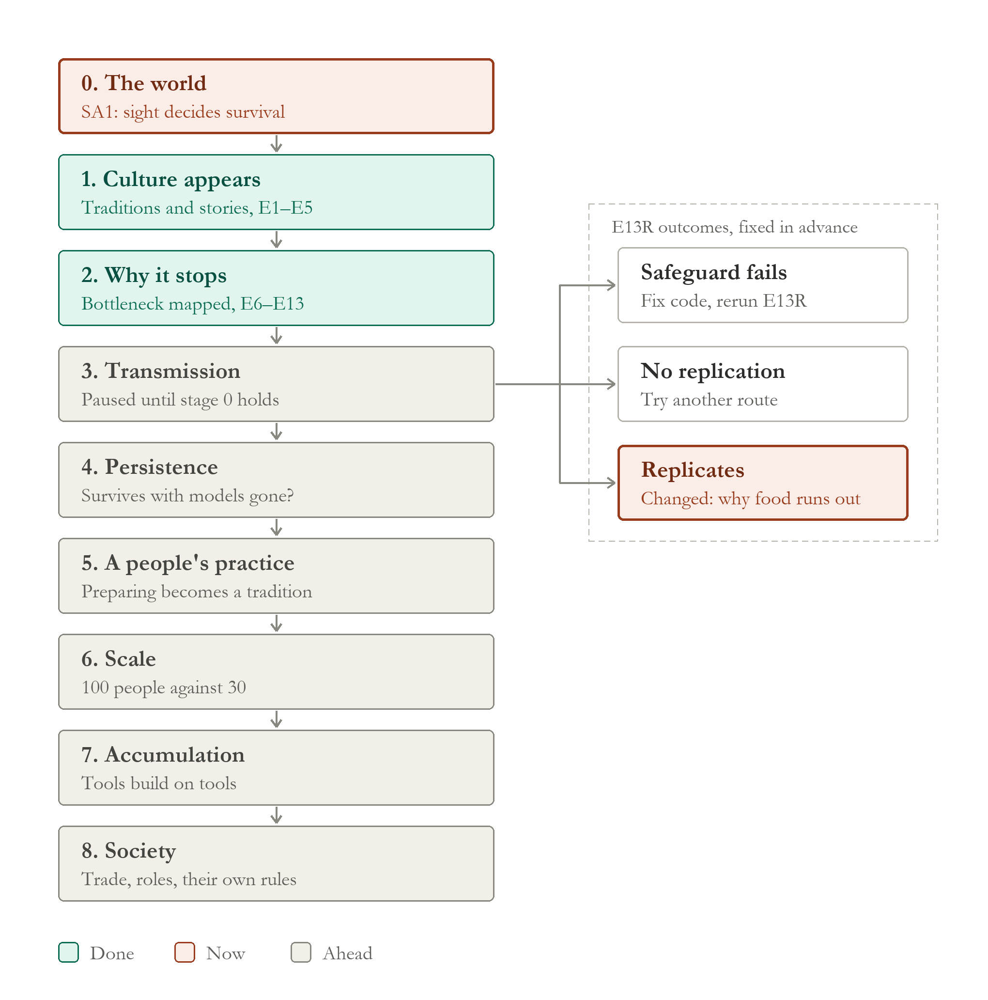

# ACL roadmap: the pathway

Read this first when the project feels lost. It says where ACL is, what comes next, and how each next step is decided.
It is updated after every experiment, like the book.

**Last updated:** after WS1 (12 October 2026).

*The picture is drawn by [`docs/make_roadmap.py`](docs/make_roadmap.py) (also as [SVG](docs/roadmap.svg)). After each
experiment, edit its stage list and run `python docs/make_roadmap.py`; the book uses the same picture.*

---

## The goal, in one line

Civilization emerging in a world where **nature is programmed and culture is written by nobody**: people who keep,
pass on and build on what they learn, until their practices outgrow any one life.

## Where we are

| stage | question | status |
|---|---|---|
| 0. The world | Is there a world worth living in? | **reopened (October 2026):** a third of control worlds die out of failed pairing (F1). **WS1: in these worlds, more founders (in larger bands) cut extinction; more land alone did not** (80 founders: 0.8–9% die out, against 42%); next: do bands meet (MB1a), and a new baseline (creator's decision) |
| 1. Culture appears | Does anything cultural emerge unscripted? | **done** (E1–E5: traditions, trust, stories) |
| 2. Why it stops | Where does the chain from possible to practised break? | **mostly done** (E6–E12) |
| 3. Transmission | Can a useful practice pass between adults? | **paused until stage 0 is settled;** was in progress: a habit passes, a plan does not; now: why food does not last through winter |
| 4. Persistence | Does it last when nobody is there to copy? | next |
| 5. A people's practice | Does it become a tradition of the whole people? | later |
| 6. Scale | What do larger, connected populations keep? | later |
| 7. Accumulation | Do practices and tools build on each other? | later |
| 8. Society | Specialisation, trade, rules made by the people | far |

### What stage 2 found (the chain, in one paragraph)

Winter kills, and autumn offers enough to prepare (E8). People could learn to expect winter, but faintly, and those who
did prepared (E9). A carer's store protects their children five-fold (E9.2). But preparing removes the hunger that taught
it, so planners stop (E9.3, E9.4). Loss and witnessing barely move people (E10). Stories reach everyone, too faintly
(E11). Planners were seen and respected, and not copied, because no adult could copy another (E12). Copying the visibly
successful gave the strongest lead yet, but its safeguard could not be measured (E13). E13R measured it: the copying acts
only through the watcher's own habit, and what passes between adults is a general habit of foraging while moderately
stocked, learned from anyone better fed, not winter preparation. Children were not saved.

---

## Stage 3, now: E13R and what follows it

These branches were fixed before E13R's result, so the path could not bend to fit what came out.

**E13R result: B replicates (R2, R3, R4 held), N carries it.** The headline (repeat planning) failed, neighbours did not
change and children were not saved. **Branch taken: "B replicates, N carries it".** Before stage 4, the assistant
recommends a read-only autopsy: why better-stocked carers did not protect their children, and whether the spread habit is
linked to preparation at all. **Autopsy done** (`experiments/E13R_replication/autopsy/findings.md`): stocked carers
still protect children, but at every food level children in the copying worlds starved more; the copied habit is
year-round, not autumn; people enter winter with more food (16 of 16 worlds) and end it with none. Copying did not help
winter. What is missing is not getting food but making it last until spring.

**Branch changed by the creator (after the autopsy):** instead of stage 4 (testing whether the copied habit persists),
stay in stage 3 and **investigate why food does not last through winter**. Reason: the habit E13R found is not
preparation and did not help winter, so making it persist would not move the project; the autopsy points to keeping
food, not getting it. Recorded openly, as a change made after the result and why.

**W1 (winter ledger) done** (`experiments/W1_winter_ledger/findings.md`): food does not fail to last; almost none is
held. Winter is lived hand to mouth (winter gathering covers 102% of winter eating; stock at the start, 14%). The median
family holds 11% of its winter need; rot is minor; stashes, the only way a family can hold a winter, are almost unused.
People gather about what they eat in every season.

**S1 (stashing decisions) done** (`experiments/S1_stash_decisions/findings.md`): stashing fails three gates in a row:
rarely eligible (food above two weeks' household need in 13% of adult-weeks, 2.7% in autumn), often displaced (a
material takes the one put option in 28% of eligible weeks), usually outscored (5.4% of offers; beaten by giving 39%,
talking 23%, joining 17%, foraging only 4%). Stashers learn it kept food better than carrying it, never that it saved a
winter; the belief spreads. The creator's hypothesis (reward values only present hunger) is partly supported: put earns
no immediate reward and its habit is a quarter of foraging's, but the strongest rival is social.

**G1 (who receives the food) done** (`experiments/G1_who_receives/findings.md`): 72% of gifts go to family, a third
to siblings (16 of 16 worlds); 63% to people with under half a week of food; 53% is repayment; strangers 1.4%. A
family's surplus is held in its members' stomachs and debts, not in a store.

**P1 (risk pooling) done** (`experiments/P1_risk_pooling/findings.md`): the family network pools risk (family food cuts
the poorest members' winter starvation 25-fold; deaths rarely amid plenty; giving does not leave givers short) but pools
almost nothing (help follows ~10% of hungry weeks; families hold a ninth of their winter; more sharing, no better
winters). The bottleneck is not distribution but how much there is to distribute when winter comes.

**U1 (upstream surplus) done** (`experiments/U1_upstream_surplus/findings.md`): the food is on the land and barely
touched; autumn is foraged like any season; no carrying limit, little moving. People stop when fed: foraging falls from
86% of autumn weeks (under half a week of food) to 6% (two to four weeks). In the code, hunger is 1 − weeks ÷ 2, zero at
two weeks, exactly the line where stashing becomes possible. **The chain from E8 to U1 now runs to one line of nature:
when a person stops feeling hungry.**

**N1 candidates written** (`experiments/N1_satiety/candidates.md`, no code, no experiment): thirteen readings of "what
should a satisfied person feel?", each judged for nature, culture, scripting risk, human capacity and leak. C6 (seasonal
instinct) and C9 (food brings standing) rejected; C3 (smooth satiety), C4 (insecurity learned from experience), C11 (the
body as a store) and C8 (a longer mind, not satiety) stand out.

**N1 evidence and least-change documents written** (`experiments/N1_satiety/evidence.md`, `least_change.md`; no code,
no choice): human evidence verified against PubMed and Crossref. Strong for C11 (body reserves), strong capacity but
weak use for C8, moderate and mixed for C4, moderate and general for C3. The least change that addresses U1 directly is
C3 scoped to `food_hunger` (one expression, three uses, one number, zero check possible). Caution: human
immediate-return societies store little despite full foresight, so C0 (no change to nature) stays on the table.

**Reframed (the creator, after N1's evidence):** U1 identified a candidate bottleneck, not a proven flaw. ACL may have
converged on an **immediate-return** mode of life (Woodburn 1982), a normal and stable human pattern, rather than a
broken one. The question shifts from "what should satiety be?" to **"under what conditions do delayed-return societies
emerge, and does ACL's world contain them?"** **N2 design document written** (`experiments/N2_immediate_delayed/design.md`):
ACL already shows immediate consumption, little storage, reciprocal kin sharing and no binding commitments; it lacks
sharing on demand, possession of stores and any capacity to ask or promise; whether its world offers dense, predictable,
storable resources is unmeasured. The N1 candidates stay, as hypotheses to weigh against this one.

**D1 (is delayed return adaptive in ACL's world?) done** (`experiments/D1_delayed_return_world/findings.md`).
Part A, largely no: food is predictable (tile r 0.90) and storable as seed, but not dense (the richest 10% of land holds
24%), and winter is barely lean (land food per person 504 against 582 in autumn); the world favours immediate-return
living. Part B, yes but: sowing returns 2.36 food per seed and is repeated (77% sow again), but 52% of its crop is
eaten by non-kin, sowers' belief falls more often than it rises, and it is 1.6% of food. **By the creator's rule,
changing people's psychology is premature.**

**D2 (why sowers learn failure) done** (`experiments/D2_sowing_learning/findings.md`): they don't. D1's measure was
confounded with belief fading (corrected in D1 and the book); setting fading aside, experience raises sowers' belief in
55% of sowings and lowers it in 30%. But returns are not captured: the sower's family gets back 1.08 per unit of seed
(autumn sowing 0.84, a loss); others harvest more. Sowing explains part of the absence of delayed return (no
possession), not all of it (it stays small, likely held by S1's gates; and winter is barely lean). **Priority as set by
the creator: N3 evidence review next, then an L1 pilot if the evidence supports it, then L6.**

**Rule for property (the creator, after D2):** possession is a dangerous lever. "Storage didn't emerge → add ownership
→ storage emerges" would write the answer in. If property is studied, the same order as everything since E13R applies:
read-only first, map it completely, then candidates, then evidence, then the least change, then an experiment.

**N3 candidates written** (`experiments/N3_lean_season/candidates.md`, no code, no choice): nine readings of a harder
lean season, judged for realism, tuning risk, targeting, effect from the rules, viability and continuity. Why winter is
mild now: winter regrowth roughly cancels dieback, and a forage week only bites when a tile falls below about 20. L1 (no
growth in winter) is the cleanest but may change little by arithmetic; L6 (colder places, leaner winters) the most
realistic; L2 and L3 bite but turn on dials; L8 (crop survives winter) rejected; L7 is about people, not the world.

**N3 evidence review done** (`experiments/N3_lean_season/evidence.md`; no code): strong support for L1 (temperate plants
are dormant in winter; zero growth is the realistic value) and L6 (lean seasons vary with climate); partial for L2 (short
seasons leave foragers plant-poor, but no rate is given, and real foragers turn to meat: ACL's hunting is almost nil);
animals only for L3. Real people meet lean seasons by meat, body reserves, moving and storing, so any harder-winter
experiment must count a non-storage answer as a finding. Storage in human foragers goes with predictability, richness and
clumped, owned resources. **N3 in the book (Chapter 48). L1 pre-registration drafted** (`experiments/L1_no_winter_growth/preregistration_draft.md`,
not frozen): one setting changed (winter plant regrowth 0.15 → 0, no code change), control and L1 on seeds 601–616, a
survival pilot on 701–704 read for survival only, and a frozen test of the immediate-return hypothesis (removing winter
growth alone will not create substantial delayed-return behaviour).

**L1 frozen (`L1-frozen`); survival pilot triggered the stop rule:** 2 of 4 pilot worlds died out (702, 704), so the
experiment did not run. A post-pilot survival-only diagnostic (recorded before it ran: the unchanged world on the same
seeds) found both explanations partly true: seed 702 dies in the unchanged world too (fragile), seed 704 dies only under
L1, and every surviving L1 world ends smaller (31 against 44; 32 against 94). Removing winter growth materially harms
survival and population: winter growth is an important stabiliser of ACL's world. **The creator chose: redesign the pilot
with same-seed controls** (recorded in the book, Chapter 49). **Draft written**
(`experiments/L1_no_winter_growth/pilot2_and_amendment_draft.md`): a new pilot on seeds 711–718, both arms, survival and
population only, stopping on excess extinction against the control; and Amendment 1 to the frozen design for the
population confound (population beside every measure, verdict on paired surviving worlds). **Signed off and frozen (`L1-pilot2-frozen`).**

**L1 done** (`experiments/L1_no_winter_growth/results.md`): the redesigned pilot passed (C lost 3 of 8, L 1 of 8). The
main run was valid; **outcome A**: the manipulation check failed, because L1 worlds ended far smaller (final median 6
against 30) and so had as much winter food per person (design flaw admitted: measured per person, not per tile). 0 of 3
delayed-return criteria on six paired seeds; by the frozen rule the null says nothing about lean seasons. Post-hoc
observation: a steady leaner winter was absorbed by density, not by behaviour, as the human evidence suggests. A lean
season people cannot adjust to by numbers (unpredictable bad winters, L5) would be a different test.

**New hypothesis, created by L1 (the creator):** **H-L5:** *delayed-return behaviour is primarily an adaptation to
uncertainty rather than to average scarcity.* Sharpened from P1 (to be checked against the literature): storage should
answer bad years that strike everyone at once (correlated risk) more than misfortune that strikes some (idiosyncratic
risk, which sharing covers). **N4 candidates written** (`experiments/N4_uncertain_winters/candidates.md`): U0 keep, U1
wider swings, U2 rare severe winters, U3 runs of bad years, U4 patchy bad years, U5 unpredictable timing, U6 (harsher
and more variable: not a test of H-L5). L1's lessons bind all of them: mean-preserving, per-tile manipulation check,
same-seed controls, population beside every measure.

**Overnight (the creator asleep):** **N4 evidence review done** (`experiments/N4_uncertain_winters/evidence.md`): the
sharpening holds (sharing insures idiosyncratic, not aggregate risk: Ravallion and Chaudhuri 1997, Townsend 1994,
Hoogeveen 2001), but uncertainty can also favour sharing and moving (Lewis et al. 2014); real grassland production varies
~37% a year (Shi et al. 2014). **V1 done** (`experiments/V1_bad_years/findings.md`): ACL's food varies ~7–8% a year; bad
winters kill (~7× starvation in the poorest quarter) but do not teach storage (more sowing, a few more planners, no more
household stock, fewer stashing); poor years cluster (0.73). **U design drafted** (`experiments/N4_uncertain_winters/preregistration_draft.md`,
not frozen): control vs wider world-wide years (W, settings only) vs wider patchy years (P, new code), width calibrated to
real variability by measuring land only. **Signed off** (grassland target, quarters for regions).

**U, October 2026: stopped at the pilot** (`experiments/N4_uncertain_winters/pilot_stop.md`). Calibration (land only):
even the widest weather (0 to 1.9) moves autumn food per tile only ~11% a year against ~37% in grassland; the widest was
used by the frozen rule and the shortfall recorded before freezing (`U-frozen`). Pilot at that width: worlds died out
C 4, W 7, P 6 of 8; all three arms alive in 0 of 8: **hard stop**, main run not done, no behaviour measured. In ACL's
present world no weather setting gives realistic food variability, and the closest one kills. Also exposed: half of
control worlds die out within 120 years, which limits every paired design. **The design returns to the creator**
(options in `pilot_stop.md`: stop U; a narrower width by a new advance rule; make the land itself vary; first address
baseline fragility).

**The creator chose option 4: F1, baseline fragility** (`experiments/F1_baseline_fragility/findings.md`; read-only,
40 saved control worlds, confirmed on 24 new). Control worlds die out at **34%** (22 of 64), not from hunger, food or
neglect: **births stop 40–65 years before extinction and the people age out.** Women of childbearing age have no partner;
pairing happens mostly among the founders; in small worlds a partner is almost never within sight, because people court
only within 4 tiles on a 40 × 40 world. Worlds that lose more children early are smaller by year 20 and do not recover.
They can be identified decades ahead (population at year 20; at year 30, population below the 20 founders and at most
three fertile women). **This is a gap in stage 0 (the world), not in culture:** every stage 3–5 result has been read on
worlds a third of which were ageing out. Rules 12 to 19 were added during F1. **Next: the creator decides** whether to
reopen stage 0; any change to how people find partners must be anchored to real evidence (rule 17) and checked for
feasibility first (rule 12).

**Stage 0 reopened by the creator (October 2026).** Stage 3 is paused until the world can sustain its people.
**N5 evidence done** (`experiments/N5_mate_search/evidence.md`): real foragers find spouses in networks of hundreds
(mating pool ~500, Pearce 2014; minimum viable population ~75–150 even when any partner can be found, White 2017; more
with space, Wobst 1974), by looking outside the local group (Kramer et al. 2017), through fluid camps (Hill et al. 2011;
Dyble et al. 2015), aggregations, and mostly kin-arranged marriage (67–85%, Walker et al. 2011). Random movement fails at
low density (Pearce). ACL: the whole world is 20 founders, below every estimate; search is random within sight; ACL has
no physical scale. Most real means are culture and may not be written; memory of people known, travel and dispersal are
nature. **Next (assistant's view; the creator decides):** a read-only feasibility check (rule 12): would 20 founders
persist even with perfect search? Then size before search.

**F2 done** (`experiments/F2_perfect_search/findings.md`; signed off and frozen; a diagnostic copy with perfect partner
finding on F1's 64 seeds): **7 of 64 died out against 22, frozen verdict "both"**. Search is most of the problem
(17 of 22 saved; populations grow, median 67 against 28 at year 120); size is real at the margin (in the 7 that still
die, no eligible partner existed anywhere: tiny worlds run out of non-kin of the right age). Two new limits appear once
people pair: couples drift apart (out of reach in 46% of women's weeks; corrected by C1: per couple 58% in the control
and 65% under F2, so couples were already apart about half the time), and larger peoples meet the food limit
(starvation half of all deaths). **Next: the creator decides** among size (M1), anchored search or dispersal (M2/M3),
and couples' proximity; any choice anchored (rule 17) and checked for feasibility (rule 12).

**C1 done, the creator's choice** (`experiments/C1_couples_apart/findings.md`; read-only, confirmed on a holdout):
ACL's couples are apart about half their weeks in the unchanged world. Two in five apart weeks sit at exactly 3 tiles,
in a gap between two separately written thresholds (conception within 2; the pull toward a partner only beyond 3).
Partners forage independently and foraging makes most splits; beyond reach the pull is present but outbid by food; a
third of reunions are chance. Nothing in nature keeps a couple together while they forage. C1 also corrected F2's
"20% → 46%" (per couple 58% → 65%). **Next: the creator decides**; candidates (the threshold gap, a shared camp, the
pull's strength) each need evidence first (rule 17).

**N6 evidence done, the creator's choice** (`experiments/N6_living_together/evidence.md`): real foragers return to a
central place each night; spouses often forage apart by day but share a camp; separation lowers fertility. At ACL's
weekly step a real couple would be together almost every week, so ACL's "apart half the weeks" has no counterpart; the
gap is the absence of a shared home base. Candidates: align the thresholds (L1), a shared home base (L2, best
anchored), a pair bond at any distance (L3); division of labour and residence rules are culture and may not be written.
**Next (assistant's view; the creator decides):** a read-only feasibility check (rule 12) of how far apart partners'
personal homes lie today, then a design for sign-off.

**H1 done** (`experiments/H1_partner_homes/findings.md`; read-only, rule 12): partners' homes lie within conception
distance only about half the time; about 30% are 4 or more tiles apart; homes change in about 18% of adult-weeks.
Frozen rule: **mixed**. Aligning the thresholds (L1) alone would leave much of the separation; a shared home base (L2)
is what the evidence points to. **Next: the creator decides** (L1, L2, or L1 then L2 as separate experiments).

**The creator chose L1 then L2, as T1 then HB1, then F3 comparing them.** **T1 done** (`experiments/T1_threshold_align/
findings.md`; signed off and frozen): the manipulation check failed (apart weeks at 3 tiles did not fall), so its outcome
is not read. Diagnosis: the added pull was among the top options but food outbid it, as C1 found beyond 3 tiles. The
missing piece is a shared place that foraging returns to, not a pull toward a partner's position. Also learned: a slight
change flipped the fate of 19 of 64 worlds (sign test p = 0.36 on 22 → 27), so differences of a few worlds are noise.
**Next: HB1 (a shared home base)**, designed from N6's evidence, with a sham arm to measure the noise, for sign-off.

**HB1 done** (`experiments/HB1_home_base/findings.md`; signed off and frozen, with a sham arm): couples were together
almost every week (apart 57.8% → 0.1%) and had more children, but **extinction rose (33 of 64 vs 22; p = 0.043; sham
p = 0.815)**. Exploratory: food near fixed homes ran short, adults and teens starved, widowhood rose and pairing slowed;
crowding illness was not the driver. HB1 gave couples a central place without the residential mobility real central
places have (Garg et al. 2021: foragers forage near home or move home to new areas). **Next: the creator decides**:
HB2 (a home that moves with the food), or first measure food around homes read-only.

**The creator chose to measure first. HF1 done** (`experiments/HF1_home_food/findings.md`; read-only, signed off,
holdout on new seeds): **not confirmed**. The land around HB1's homes was only about 3% less full than the control's
(0.970 / 0.976); HB1's extra starvation repeats on new seeds but local depletion did not cause it. By the frozen design,
**HB2 is not designed until the cause is found.** Leads for the next read-only check: hunting fell under HB1; HB1's
couples had more children, and carers feed dependants first.

**HF2 done** (`experiments/HF2_household_food/findings.md`; read-only, signed off, holdout on new seeds): **neither**
frozen lead. Not mouths (HB1's carers had only 8–12% more dependants, and the extra hunger falls on every kind of adult);
not meat (meat is about 0.02% of ACL's food). A lead written before the holdout and repeated in it: **under HB1, people
gave each other about two fifths less food**, about three quarters of the drop in what adults took in. Consistent, not
formally confirmed. **Next: the creator decides**; proposed HF3, a pre-registered read-only test of why gifts fell and
whether losing them predicts starving. HB2 still waits.

**HF3 done** (`experiments/HF3_gifts/findings.md`; read-only, signed off, holdout on new seeds): **not supported**.
Gifts fell, but starving adults under HB1 had someone with food to spare within reach as often as in the control;
meetings did not fall; surplus and choice both fell a little, channel not identified. **After HF1–HF3, HB1's hunger is
real and repeats, but no single cause tested explains it** (not depletion, children, meat or gifts). Remaining
hypothesis, not a finding: many small shifts pushing adults over the starvation line. **Next: the creator decides**:
HF4, a read-only hunger ledger testing that hypothesis, or close the HB1 question and return to keeping couples
together with a different design.

**HF4 done, and the HB1 question closed** (`experiments/HF4_hunger_ledger/findings.md`): by the frozen rule, **small
shifts explain the hunger**: under HB1 the food adults hold when they eat fell about 6–7% across the whole
distribution (no tail of a few badly-off people). Caveat recorded before the holdout: the shift accounts for about half
of the *extra* starvation. A shared home, as HB1 built it, made people hungrier through a broad, modest fall in food
held, not one failure; HB2 is not designed. **Next (the creator's decision at sign-off): return to keeping couples
together with a different, evidence-anchored design** that does not tie each week's foraging to a fixed home.

**N7 done** (`experiments/N7_couple_designs/candidates.md`, `evidence.md`): candidates K0–K4; evidence that foragers
return to a central place each day and move it as local returns fall. **K2, a camp that goes where the couple goes,
is anchored; K1 is dropped** (no evidence turns a day's range into ACL tiles, and its threshold would act on births).
Feasibility already in the record: couples are beyond reach in 28–29% of couple-weeks (C1). **Next: the creator
decides whether to design K2** (with a sham arm, a paired test and HF4's ledger from the start).

**MC1 done** (`experiments/MC1_moving_camp/findings.md`; K2, signed off and frozen): couples apart 57.8% → 17.0%,
births +12%, **no extra hunger** (food held at eating unchanged), but **no detectable effect on extinction** (26 vs 22
of 64; p = 0.503; sham p = 0.815). The first change in this series that is anchored, achieves its aim and does no
harm. **The thread ends here: pair stability limited births, not survival.** F2's lever, finding partners, remains.
**Next: the creator decides**: realistic, anchored mate search (N5's M2/M3); whether MC1 joins ACL's nature; size
(M1) for the smallest worlds.

**N8 done** (`experiments/N8_partner_finding/`): candidates P0–P5; evidence: **P1 (walk to where you last saw a known
single) not anchored** (knowing many people across camps is supported, tracking where they are is not); **P2 (leave
when there is no one) anchored in behaviour**, with no timing anchor, so only a timing-free form: outward instead of
random steps when no eligible partner is in sight. **Power:** detecting half of F2's effect needs about 192–256 worlds;
64 detect only large effects (so MC1's null cannot rule out a modest benefit). **Next: the creator decides** whether
to design P2 (outward dispersal) at that size.

**MC1-L done** (`experiments/MC1L_moving_camp_large/findings.md`; MC1 re-tested at 256 new seeds, frozen): control
87 of 256 died out (34%); couples apart 57% → 16%, births +15%; **extinction 93 vs 87** (p = 0.532; sham p = 0.248);
effect −0.023, 95% interval [−0.086, +0.039], below half of F2's effect (0.116). **Frozen rule: MC1 is genuinely
weak.** Pair stability limits births, not survival: now a confident null. The sham's noise matched the power model.
**Next: the creator decides** whether to design P2 (outward dispersal) at 256 worlds.

**P2 stopped at its pilot** (`experiments/P2_outward_search/pilot_stop.md`; signed off and frozen: outward instead
of random steps for seekers with no eligible partner in sight, direction only). Seekers have no one in sight in 95%
of their weeks, but the search wins against food, water and home so seldom that the outward step was taken in
**3.9% of trigger weeks** (frozen gate 5%). Main run not started. **The question is now how much people search, not
where;** only evidence may set that. **Next: the creator decides** (evidence on time spent seeking others; a
direction-only variant; or N8's other candidates).

**N9 done** (`experiments/N9_search_effort/evidence.md`; questions frozen before search): how much the unpartnered
search is **partly anchored, direction only**: visiting and residential change are frequent across foragers, men
range more widely, but no source read gives how often a person travels or what share of time, and none compares the
unmarried with the married. **No number can be set; P2 is closed in its present form.** Lead: a read-only check of
how fluid ACL's groups are, against "stable over months, not years". **Next: the creator decides.**

**GF1 done** (`experiments/GF1_group_fluidity/findings.md`; first named G1, renamed because G1 was already taken by "who receives the food"; read-only, discovery + holdout): of adults living together,
85% still are after 4 weeks and **78% after two years**, in both sets; the curve is flat after the first month, and
the unpartnered do not move more. **Frozen reading: ACL's groups are more fixed than forager bands** (direction only).
Three sides now agree: F1 (partners not found), P2 (singles rarely search), GF1 (groups hardly mix). **Next: the
creator decides** (e.g. candidates for movement between groups, evidence first).

**N10 done** (`experiments/N10_world_size/evidence.md`; asked by the creator: is 40 × 40 too small?): **population
size anchored**: viable forager populations need ~75–150 people (White 2017), real ones average ~840 (Hamilton et al.
2007); ACL's 20 founders make one aggregated band, below viability. Density and tile scale not anchored. The idea is
supported **in people**, not in space alone. **Next: the creator decides** whether to design S1 (people and land
scaled together at ACL's own density; feasibility first).

**WS1 done** (`experiments/WS1_world_size/findings.md`; first named S1; frozen; 256 new seeds; valid, sham quiet). Baseline:
C (40 × 40, 20 founders) died out in **107 of 256** worlds (41.8%). **More land alone: no meaningful effect** (L, 80 × 80
with 20 founders: 108 died out; interval excludes half of F2's effect); survivors grow larger, not safer. **More
founders: survival improves**, with land (LP, 80 × 80 with 80: **2** died out; +0.41) and without (P, 40 × 40 with 80:
**23**; +0.33). Population, not a slow decline: P settles at ~50 people for 90 years, LP at ~140. Caveat: more founders
came in larger founding bands (4 of 20), so founders and band size are not separated (MB1a, then MB1 Stage B). Prior
"L worse than C" was wrong; "LP better than L" right. **Next: the next-phase plan below, for the creator's sign-off.**

**AA1 done** (`experiments/AA1_artifact_audit/findings.md`; read-only; frozen; discovery and holdout agree). One
**unintended** shortcut is material: **A1**, walking across water at a corner without anything that floats (83% / 30%
of water crossings), but only in about **one world in three**, where a hidden land bridge joins settled land. Four
**information** shortcuts nobody wrote a rule for are material and present in every world: people walk toward where an
absent loved one is *now* (A5, ~30% of go-to moves), partner search aims beyond sight (A6c, ~56%), gifts are sized on
the receiver's exact food (A6a, ~13% of wild food), dryness is judged from water beyond sight (A6d, ~7%). Nothing fixed;
none shown to have changed a finding (every arm of every study has them equally). **Next: the creator decides** which
are flaws, and whether A5/A6c are tested as their own controlled comparison before any new version of nature.

**LK1 done** (`experiments/LK1_location_knowledge/findings.md`; frozen; 256 new seeds; valid, sham quiet). A5 (walking toward where an absent loved one is *now*) was replaced by walking to where they were **last seen**. Baseline C died out in **90 of 256** worlds; M in **87** (p = 0.822; effect +0.012, interval [−0.059, +0.082]). **Frozen rule: no meaningful effect on survival.** Families spend more time apart (partner-weeks out of sight 21% → 28%), but partner finding, births and A6c did not move. A5 acts on existing ties; worlds die for want of new ones. Prediction "partner finding falls" was wrong. **Next: the creator decides** whether last-seen memory goes into nature v2 (with A1); SA1 runs now. **Decided (13 October): approved for nature v2 with A1, built after BL0 as one change.**

**SA1 done** (`experiments/SA1_sensitivity/findings.md`; frozen; F1's 64 seeds; valid, sham quiet). Six unanchored settings, each halved and doubled. **How far people see decides survival:** sight 2 tiles → 49 of 64 worlds died out, 8 tiles → 8 (control 22). Doubling range (`reach` 6) and the mortality scale also raised extinction; halving food did, but not after the correction for twelve tests. Conception and camp radius showed no sign at 64 worlds (not proof of robustness). Every extinction finding now carries "rests on an unanchored value that moves survival strongly". Nothing adopted. **Next: the creator decides** the 256-seed follow-up and the evidence reviews (sight, range, mortality); MB1a runs now.

**MB1a done** (`experiments/MB1_multi_band/findings_mb1a.md`; read-only; frozen; discovery and holdout, 192 replays exact). Do bands meet? **Today's world: at the line** (0.050 / 0.049 per adult pair-year; no reading). **80 founders on today's land: rarely. 80 founders on four times the land: effectively closed** (0.0007), yet that world survives best: its bands are big enough to carry themselves. Interaction is a quarter of meeting or less. **Next: the creator decides** MB1b (as drafted it runs in the closed world) and the new baseline; ID1 runs now.

**BL0 done** (`experiments/BL0_habit_use/findings.md`; read-only logging copy, exact; discovery and holdout agree). **Habits steer** one adult choice in seven (0.140 / 0.139), **but more than half of what they hold is copied in talk** (57% / 56%); own experience 37%, caregivers 6%, birth nothing. Everyone's habits end up alike (a stranger's correlate 0.92 with one's own, the parents' 0.96). **Next: the creator decides** the talk-copying question (today's rule, situation-specific copying, no copying), nature v2 (last-seen + A1, now unlocked) and viewer fixes 6 and 7.

**ID1 done** (`experiments/ID1_memory_identity/findings.md`; Amendment 2; valid in both sets). **No single part makes an ACL person who they are; their acquired parts together do, and temperament does not hold them.** Whether they become like the donor, and whether restoring brings them back fully, the sets disagree: no reading. With BL0: identity in ACL is spread thin over weak parts, much of it shared by everyone.

**TC1 done** (`experiments/TC1_talk_copying/findings.md`; frozen; W reproduces BL0 exactly). Three ways of learning from talk: today's whole-table copying, copying only what the speaker is living now, and none. **Frozen reading: unresolved** (both sets): removing copying makes families' habits only a fifth to a third more distinct from strangers'; most of the sameness stays. **But whose habits they are flips:** own experience 37% → 65% / 75%, with habits steering exactly as much and no change in survival. **Next: the creator decides** whether situation-specific copying goes to an evidence review as a nature candidate; the nature v2 comparison runs now.

**NV2 done** (`experiments/NV2_nature_v2/findings.md`; frozen; Amendment 1; zero checks pass). Nature v2 (last-seen memory, the A1 corner fix, the ST1 raft fix and the knowledge-record copy) against v1 on 256 new worlds: **no meaningful effect on survival** (94 against 97 died out; interval inside the yardstick), births and partner finding unchanged. Three unintended channels and one bookkeeping flaw removed at no measurable cost. The sham came close to the yardstick by chance alone. **The creator signed off v2 (16 October 2026; tag `nature-v2`)**: new studies start from it; every past result stays on v1. The SA1 follow-up (on v1, as SA1) runs now; then MB1b.

**HS1 done** (`experiments/HS1_habit_sameness/findings.md`; frozen; read-only). Why is everyone's habit table alike? With no copying, **a stranger from a different world is exactly as like a child as a stranger from their own world** (0.838 against 0.839): sharing this world's map, neighbours and history adds nothing; the sameness comes from the nature every world shares. Families still add their own (0.92). It sharpens TC1: copying is not why people are alike. **Also drafted and frozen:** RT1, residence time (ACL's people change place 2.5 times as often as forager camps; SA1-F's evidence review), Amendment 1 approved; it runs after SA1-F.

**SA1-F done** (`experiments/SA1_sensitivity/findings_f.md`; frozen; 2,304 worlds). At proper power **all seven settings move survival**, six beyond the yardstick: sight above all (halved, 168 of 256 worlds die; doubled, 31; control 82). The three near-the-line settings (foraging, conception, short reach) were real effects. ACL sits near a demographic edge on several unanchored numbers: extinction findings stay relative. Its evidence review found that ACL's people move 2.5 times as often as forager camps, which became **RT1 (residence time), running now**. **Next: MB1b's setup, documented before any run.**

**RT1 done** (`experiments/RT1_residence_time/findings.md`). Moving camp every 4 weeks, as built, made worlds die out far more (164 against 93 of 256), through **thirst**: people walked to water and were sent back to a dry base, so the trip did not count. It tests this base rule, not forager residence. **FX1** (evidence review): ACL's people eat 99% picked-up plants; foragers 8% (a third extracted, 60% hunted); hunting in ACL pays a twentieth of foraging. **Next: the creator decides MB1b (drafted), RT1b, and whether FX1's candidates become studies.**

**CA1 done** (`experiments/CA1_chain_audit/findings.md`; frozen; read-only). Where does the chain of cumulative culture break? At the first hand-over: **about nine in ten useful inventions are never learned by anyone but their inventor**, in both sets of worlds. What is passed on mostly survives and mostly becomes part of something better; nearly everything passed on goes by teaching, almost nothing by watching. **Also signed off and frozen:** MB1b Amendment 1 (running), RT1b and FX2 (queued after it). **Next: read-only checks of why teaching passes on so little, and whether "built on" is one person's own work.**

**CA2 done** (`experiments/CA2_teaching_gates/findings.md`; frozen; read-only). Why is so little taught? Two obstacles, both repeating: **most inventions never reach a lesson** (the inventor meets no one to teach while knowing it, or does not value it enough to offer it), and **the few composites that are shown can almost never be followed**, because the learner cannot make their parts. Building on a part learned from someone else is rare (4%). **Next: the creator decides between a read-only look at meeting, and an evidence review of how real people teach multi-step crafts (before any change to nature).**

**CA3 done** (`experiments/CA3_opportunity/findings.md`; frozen; read-only). Why do most inventions never reach a lesson? **Memory**: 99% were pushed out of the inventor's 12-recipe memory within a season, before any teaching talk. And when a composite could have been taught, the learner knew its parts about one time in twelve. An evidence review (notes only) found that real learners meet the parts of a craft first. **Next: the creator decides whether to review evidence on the memory limit and on learning parts before wholes, toward a Law 126 proposal that can tell the explanations apart.**

**MB1b done** (`experiments/MB1_multi_band/findings_mb1b.md`; frozen; 1,024 worlds). Same 80 founders, divided into 4, 8 or 16 bands: **no meaningful effect on survival** (13, 8 and 7 of 256 died out), with survival near its floor at 80 founders. Smaller bands **mix far more** (couples across lineages 6% → 54%), but partner blocking and births do not move. Band size and crowding are confounded. **Next: RT1b (running), then FX2, then LM1 (waits on its Amendment 1).**

**RT1b done** (`experiments/RT1_residence_time/findings_rt1b.md`; frozen; 768 worlds). Counting the week's walk to water fixed RT1's flaw (thirst after a chosen trip 50% → 1%) but **did not save the worlds**: R4w died out as often as R4 (143 vs 148 of 256) and far more than C (91). Thirst deaths stay about 50% higher; births and partner finding do not differ. **Next: FX2 (running), PF1 (running), then LM1; a read-only look at R4w's thirsty weeks is the creator's call.**

**PF1 done** (`experiments/PF1_partner_pipeline/findings.md`; frozen; read-only; 96 replays exact). Where partner finding stops in MB1b's worlds: in about half of a single woman's weeks a suitable man is within reach and **neither courts**; the pool is almost never empty (1–3%). Smaller bands made courting more frequent but couples no more common: the extra courting was of near-strangers, who can almost never accept. **Next: the creator decides on a read-only look at what is chosen instead of courting, and on RT1b's audit; FX2 running, then LM1.**

**FX2 done** (`experiments/FX2_embedded_food/findings.md`; frozen; 768 worlds). With half of plant food embedded and a hard thing able to open it, **people took up tools** (carried 40% vs 24% of forage-weeks, used on embedded food in 39%): the clearest case yet of a tool coming into use because it pays. **But every such world died out** (256 of 256, median year 40), so the tool benefit could not show in survival. The setting was operational and too harsh. **Next: LM1 (running in the cloud), PF2 (cloud); a gentler FX follow-up is the creator's call.**

**PF2 done** (`experiments/PF2_instead_of_courting/findings.md`; frozen; read-only; run on GitHub, 64 replays exact). In the weeks a suitable man is right there and nobody courts, courting **is** an option about nine times in ten, but has about **one chance in a thousand**: food wins three times in four. When not an option, he is usually outside the 12 people she considers. **Next: LM1 and FX3 (running on GitHub); any change to courting would be a nature change needing evidence first.**

**LM1 done** (`experiments/LM1_memory_and_parts/findings.md`; frozen; Law 126 study; run on GitHub, 1,024 worlds). **Teaching a missing part after a failed lesson raises transmission** (+2.2 points on a median 9%), the first change to move CA1's bottleneck; **fixing the memory tie-break alone does not**. **Next: the creator decides whether to adopt parts-first teaching into nature (Law 126), with LM1 and CA3's evidence as the case; FX3 running on GitHub.**

**FX3 done** (`experiments/FX3_gentler_embedded/findings.md`; frozen; run on GitHub, 1,280 worlds). At gentler settings, worlds survive often enough to ask the question: **tools come into use but do not save worlds** (no meaningful effect on survival at either level); embedded food itself is what kills. **Next: the creator decides on parts-first teaching (LM1) and what, if anything, to do with embedded food.**

**TP1 done** (`experiments/TP1_tipping_point/findings.md`; frozen; read-only, 768 saved worlds). **No sharp tipping point except zero:** a world with no fertile woman almost always dies out, but above that each extra woman cuts the risk by about 10–20 points; at three, about half die (prior W* = 3 wrong). Confirmed on the holdout. **Correction after GPT's review:** among worlds of the same size, the number of women adds little; small total size carries the risk. **Next: LX1 and TU1 (on GitHub).**

**Also found (October 2026):** ST1, a small breach of Rule 3 (a raft that wears out at sea strands its owner for a
week; 22 of 1.29 million person-weeks), found by the new property tests; nature not changed. The habit table is 32 × 17
(544), not 608 (labels corrected). **Correction (18 October 2026):** that described the older live package (17 actions); every research copy since E8, and the live package since nature v2, has 32 × 19 = 608. Exact replays depend on Windows' maths library (CI on Windows Server 2022).

| E13R result | what it means | next step |
|---|---|---|
| **L1 or L2 fails** (hard stop) | the copying code does something beyond the watcher's habit | fix the code; rerun E13R. No outcomes read. |
| **B does not replicate** (R2 or R3 fails) | E13's lead was specific to its four worlds | go back to stage 3 with reading Phase 2.5: a different learning signal (Ndousse), group-level transmission (social protocell), or children learning from successful adults |
| **B replicates, N carries it** ← **taken, then changed** (see above) | what spreads is a general "forage while things are good" habit | stage 4, testing the general habit |
| **B replicates, P carries it** | planners pass on a preparation practice | stage 4, testing the planners' practice |
| **B replicates, both or mixed** | no single source | stage 4; the source question stays open in the book |

## Stage 4: persistence (the next big question)

**Question:** once people have learned from others, does the practice survive when the models are gone?

Both Ndousse (2021) and Cook (2024) found that learners can become dependent on whoever they copy. A practice that
vanishes with its models is not culture.

Candidate designs, to be chosen after E13R, not before:
- **Switch copying off** halfway through a run. Does preparation stay above the control?
- **Generations:** do the children of people who learned by copying prepare more than other children, with copying off?
- **Remove the models:** do neighbours of planners keep preparing after the planners die?

**Done when:** a practice learned socially stays measurably above the control for at least a generation without copying.

## Stage 5: a people's practice

**Question:** does preparation become a tradition, held by many people across decades, the way ACL already measures
traditions (three or more people in every ten-year sample)?

**Done when:** preparing for winter meets ACL's own definition of a tradition, and children's winter deaths fall because of
it (read last, only if the links before it hold).

## Stage 6: scale

**Question:** do larger, connected populations keep more? Henrich (2004), Kline & Boyd (2010) and Derex (2013) all say
population size and connection decide how much culture survives, and ACL's E4 found isolation in small peoples.

Likely needs faster worlds (see JaxLife and Craftax for how). **Done when:** 100 connected people against 30 has been
tested under the same method.

## Stage 7: accumulation

**Question:** with transmission working, do tools and practices finally build on each other? This returns to the problem
ACL hit in E6 to E8: the memory ceiling, the degenerative loop, and tools that pay too little. Tomasello's ratchet and
Mesoudi's acquisition costs are the theory to read first.

**Done when:** something is made that depends on something else that was learned from someone else.

## Stage 8: society

Specialisation, trade, leaders and rules made by the people themselves (README, "Not yet"). Not planned in detail;
each earlier stage will change what this one looks like.

---

## Rules that never change

These hold at every stage, whatever the results:

1. **Nature is programmed, culture is written by nobody.** Never write a behaviour you hope to see.
2. **Copying carries behaviour, never instructions or expectations.** Stories carry experiences, never instructions.
3. **Freeze predictions before any code**, tag the commit, and never edit them after the results.
4. **Pilots first**, read-only, before choosing a design.
5. **Leak tests are hard fails**, and every test states its minimum sample. An empty test counts as failed.
6. **Measurement never touches the world** (probe read-only, checked by state hash).
7. **New code with the mechanism off must reproduce the old world exactly.**
8. **Read in the fixed order:** validity, then causal links, then deaths last.
9. **Cap every conclusion** at what the evidence shows.
10. **Failures are published as failures.** Never change a verdict after seeing it.
11. **The creator signs off every design** before it is frozen.

**Added October 2026, signed off by the creator during F1 (before F1's holdout finished).** Each was paid for by a real
failure, stop, confound or correction:

12. **Feasibility before design.** Before designing an experiment around a world setting or target condition, perform a
    read-only feasibility check to verify that the world can actually produce that condition. If the condition cannot be
    produced, the design must be revised before sign-off. *(U: ACL could not reach grassland-level variability.)*
13. **Manipulation checks protect the scientific target.** Manipulation checks must be anchored to the scientific target
    being tested, not to the magnitude achieved by the manipulation itself. A manipulation that falls short of its target
    does not redefine success. *(U's check became detached from the grassland target.)*
14. **Baseline survival is reported first.** Any experiment whose interpretation depends on surviving worlds must begin
    by reporting the control survival rate and the expected number of paired worlds available for comparison. *(L1, U
    and F1 were all affected by extinction and shrinking populations.)*
15. **Discovery and confirmation are separate.** Patterns found through exploratory analysis are hypotheses until they
    are tested on fresh, unseen worlds. Findings discovered on one set of seeds must be confirmed on a holdout before
    being treated as established. *(D1 and F1.)*
16. **Every reported number must be traceable.** Every quantitative claim in a report must be reproducible from a script
    committed to the repository. Claims must not extend beyond the population, worlds, or conditions actually measured.
    *(F1's "in any world" overstatement; an earlier claim of work not done.)*
17. **Nature is anchored, not tuned.** Changes to nature must be anchored to external evidence about the real world.
    Values are chosen from evidence and fixed before running experiments. Nature may not be tuned toward a desired
    outcome. *(The temptation F1 opens: widening mate search until worlds survive.)*
18. **Population accompanies interpretation.** Population must be reported alongside any behavioral measure when
    population differences could influence interpretation. Where possible, verdicts are based on worlds surviving in
    all relevant arms. *(L1's Amendment 1, made a rule.)*
19. **Corrections are appended, not rewritten.** Errors are corrected openly through dated amendments. Earlier
    conclusions remain visible and are not silently rewritten. *(Long practice, made a rule.)*
20. **Nature gives capacities, never contents; it is anchored or labelled; and the code is checked against it.**
    A rule of nature may give people only what they *can* feel, sense, learn and do (not what, whom, where or when), must
    not name the outcome being studied, must not give knowledge without a channel, and must rest on evidence that it is
    universal. A number nature needs but evidence cannot set is labelled unanchored, chosen before any experiment, and
    never tuned. Existing code is checked against these tests, not only new changes; a rule that fails is recorded as a
    known compromise, measured, and replaced only by a tested new version of nature. The line moves only for new
    evidence or a found shortcut, never for a wanted outcome. World Bible Law 126 (v8.2); full text and procedure in
    `experiments/NL1_nature_line/rule20_draft.md`. *(Wolves; the hunger rule, U1; A5, AA1; newborn habits, NL1.)*

## The cycle for every experiment

1. Name the question, from this roadmap.
2. Autopsy or pilot (read-only).
3. Candidates document; the creator chooses.
4. Pre-registration; the creator signs off; freeze and tag.
5. Code, tests, zero check.
6. Write the analysis script before any outcome exists.
7. Run, with the safeguards first.
8. Report in the fixed order.
9. Update the record: `results.md`, `experiments/INDEX.md`, the book chapter and timeline, this roadmap.
10. Commit and push.

## How not to lose track

- **One question at a time.** No new mechanism starts until the current experiment is resolved and recorded.
- **Every idea goes in the parking lot below**, not into the current experiment.
- **When in doubt, open this file**, then `experiments/INDEX.md`, then the latest `results.md`.
- **Update this file after every experiment:** move the "now" line, and record which branch was taken and why.

## Reading alongside the stages

| stage | read (see [RESOURCES.md](RESOURCES.md)) |
|---|---|
| 3. Transmission (now) | Phase 2.5: Ndousse, Cook, Dalmaijer; Henrich & Gil-White; Kendal |
| 4. Persistence | Cook; Ndousse (dependence); Bhoopchand |
| 5. A people's practice | Boyd & Richerson; Mesoudi; social protocell |
| 6. Scale | Henrich 2004; Kline & Boyd; Derex; Craftax, JaxLife |
| 7. Accumulation | Tomasello; Mesoudi (acquisition costs); Kirby (iterated learning) |
| 8. Society | Sugarscape (as a contrast); Melting Pot; Neural MMO |

## Next-phase plan (written after WS1, 12 October 2026; FOR THE CREATOR'S SIGN-OFF, nothing decided)

**Frozen queue (unchanged):** AA1 (done) → LK1 (done) → SA1 (done) → MB1a (done) (do bands meet?) → ID1 (done) → BL0 (done) (do habits steer?).

**Decisions proposed** (each still goes through its own questions, freeze and sign-off):

1. **A new baseline world for culture studies:** 80 founders. Under 1–9% of such worlds die out, so later measures are
   not swamped by extinction.
   - **Recommendation: LP (80 × 80, 80 founders).** Today's crowding, 0.8% extinction, about 140 people.
   - **Alternative: P (40 × 40, 80).** Cheaper per world, but four times today's crowding, with more child deaths.
   - Decide after MB1a, which shows whether these worlds' four bands ever meet.
   - It is a new baseline beside the 20-founder record, never replacing it. Everything run so far stays as it was.
2. **MB1 Stage B** (same 80 people in 4, 8 or 16 bands): separates "more people" from "larger bands", the confound WS1
   could not resolve. Only if MB1a shows bands meet at least rarely.
3. **One new version of nature** (v2) bundling the fixes that need sign-off: ST1 (a float that breaks at sea puts its
   owner ashore half-drowned) and any of AA1's shortcuts judged flaws. Zero checks; new reference hashes; the old
   version kept for every past result.
4. **Back to stage 3 (transmission) on the new baseline:** learning by watching (E12/E13R: seen, respected, not
   copied), with BL0's answer deciding whether a learning mechanism comes first.
5. **Profiling** (cProfile) after AA1: LP worlds took about six times as long as today's in WS1 (~17 minutes each against ~3; 64 worlds ≈ 4½ hours on four workers), so speed decides the cost of
   every study on the new baseline. Report first; any optimisation must keep worlds bit-identical.

**Held as candidates** (evidence first, not ordered): Lévy-like search, real seasons, cooperation from conditions,
belonging and ownership, evolved instincts (below).

## Next-phase candidates (noted October 2026)

Each starts, as always, with frozen questions and an evidence review; none is designed yet.

- **Survival first:** WS1 done (more founders cut extinction; land alone did not); AA1 done (one unintended shortcut, four information shortcuts; decisions to the creator); LK1 done (A5 does not hold worlds together); SA1 done (sight decides survival); MB1a done (large worlds' bands closed); ID1 ID1 and BL0 follow.
- **Lévy-like search.** ACL's exploratory step is always 3 tiles in a random direction. Hadza foragers make Lévy walks
  (many short moves, rare long ones) in nearly half of foraging bouts (Raichlen et al., PNAS); flies search similarly.
  Rare long trips could connect bands (F1, P2, GF1). Evidence first: whether it describes moves between camps, not only
  daily foraging.
- **Learning by watching** (E12/E13R: seen, respected, not copied).
- **Seasons from real environments** (forager seasonality evidence; N4 stopped because ACL's land would not vary).
- **Cooperation from conditions, not rewards** (e.g. windfall vs steady food; P1 risk pooling).
- **Belonging and ownership** (D2, HF2–HF3; evidence mixed: Apicella et al. 2014).
- **Evolved instincts** (long term): let instinct weights evolve across generations instead of being written by hand,
  as nature's wiring came from evolution (the lesson of the fly connectome, FlyWire 2024).
- **Related work, no change of direction:** whole-brain emulation of the fruit fly (FlyWire connectome; Shiu et al. 2024;
  Eon Systems 2026, unreviewed) shows behaviour from wiring nobody wrote: ACL's founding rule at the level of neurons.
  ACL stays at the level of drives and habits, the right level for culture.

## Parking lot (ideas held, not scheduled)

- Energy cost for complexity, and senses that can be discovered (from Werld).
- Faster worlds on the GPU (Craftax, JaxLife).
- Measuring identity: copy a person into another world and see how much of them persists (Part VIII, open questions).
- Why E6's worlds were harsher (never found).
- Rival identities when separate peoples meet.
- **A language barrier.** Today "talk" passes stories, reputations, places and know-how perfectly between any two people,
  even strangers from peoples that never met: in effect, telepathy across groups. Stories and teaching could get through
  only partly between people who share little (for example, limited by familiarity or by shared marks). Matters before
  any study of separate peoples meeting.
- **Wariness of strangers, as nature?** A stranger now starts at zero on every feeling, with no caution toward the
  unfamiliar. Whether a mild inborn caution belongs in ACL's nature is an open question: writing it in risks scripting
  group conflict, so it needs the creator's sign-off and a careful design.
- Writing ACL up as a paper (Hughes et al. for framing).
