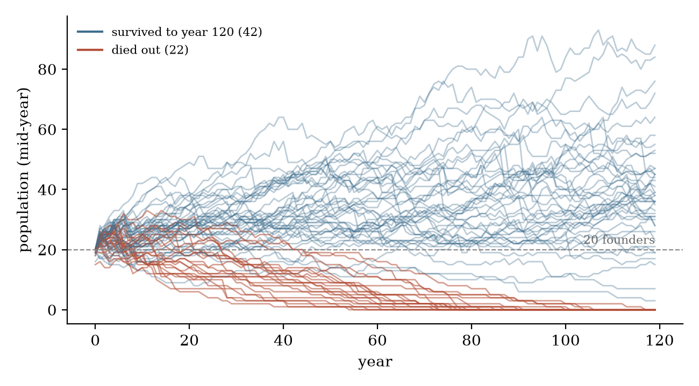
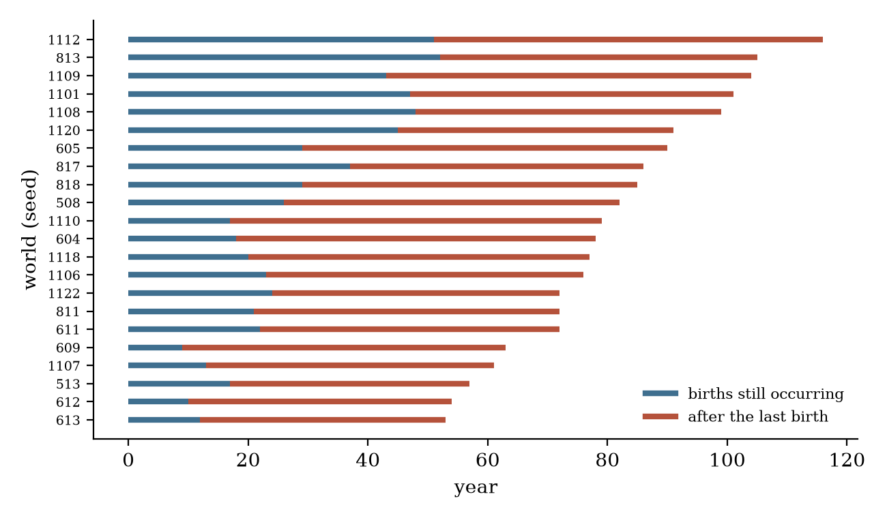
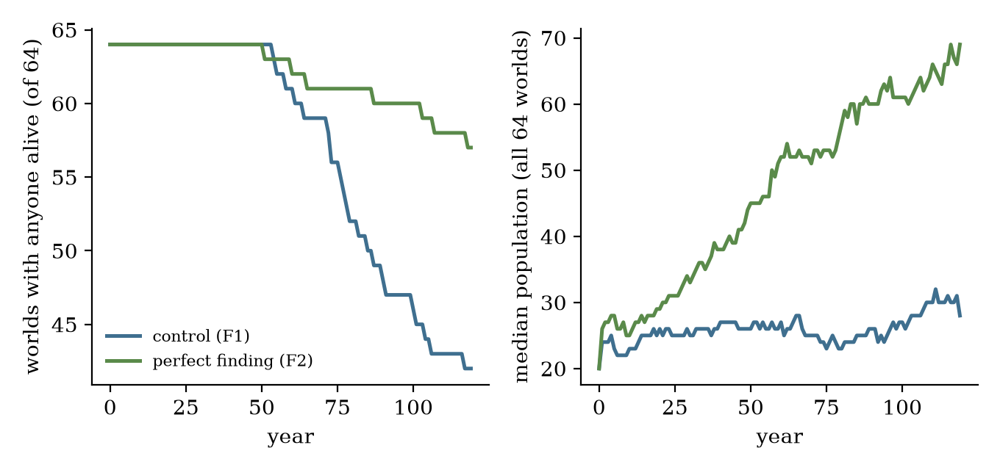

# Failed pairing, not hunger: why small simulated forager populations die out

**Abdurashid Khudoyberdiev**

*DRAFT v0.2 for the Journal of Artificial Societies and Social Simulation (JASSS), October 2026. Not submitted. Every number is generated by `paper/paper_numbers.py` from committed
experiment outputs (listed in `paper/numbers.md`); figures by `paper/make_figures.py`. Items marked [AUTHOR] need the
author's decision; references marked [VERIFY] have not been read in full in this project and must be checked.*

---

## Abstract

Agent-based models of small-scale human societies often treat population viability as a question of food: worlds die
when there is too little to eat. We report a pre-registered, read-only investigation of extinction in a spatial
agent-based model of foragers, the Artificial Civilization Laboratory (ACL), in which demography, foraging, kinship and
courtship are specified at the level of individuals and no social institutions are scripted. Starting from 20 founders,
22 of 64 control worlds (34%) died out within 120 years. Extinction was not driven by hunger: the share of
person-weeks spent starving and the food available on the land did not distinguish dying worlds from surviving ones.
Instead, in every extinct world births stopped 40 to 65 years before the last death, women of reproductive age spent
every week of the final 30 years without a partner, and the population aged out. Pairing occurred mostly among the
founders; afterwards, unpartnered women in small worlds almost never had an eligible partner within sight (98% of
single-woman-years in extinct worlds), although one usually existed elsewhere in the world. Population size at year 20
identified future extinction decades in advance (AUC 0.85 in a discovery set, 0.91 in a holdout set). In a diagnostic
counterfactual that gave every unpartnered woman perfect knowledge of every eligible partner, extinction fell from 22
to 7 of the same 64 worlds; in the seven that still died, no eligible partner existed anywhere in any year a woman was
single. A third, read-only study found that even paired couples were within conceiving distance only about half the
time. In this model, extinction is first a problem of finding partners and, at the smallest sizes, a problem of having
any. We discuss implications for minimum-viable-population estimates from non-spatial models, which assume partners
can always be found.

**Keywords:** agent-based model; hunter-gatherers; minimum viable population; mate search; demographic
stochasticity; pre-registration

---

## 1. Introduction

How small can a forager population be and still persist? Simulation studies have long approached this question
through mating networks. Wobst (1974) estimated that a demographically viable mating network for mobile foragers would
contain roughly 175 to 475 people once spatial structure is taken into account [VERIFY: read via White 2017 and Pearce
2014 only]. White (2017), using a non-spatial agent-based model in which any eligible partner can be found, estimated
minimum viable populations of 40 to 140 people depending on marriage rules, and noted that spatial constraints should
raise these thresholds. Pearce (2014) showed that random movement alone stops producing enough encounters between
groups to maintain contact across a mating pool of about 500 people once population density is low. Ethnographic and
demographic work shows how real foragers meet the problem: in small groups, adult sex ratios fluctuate from year to year
and people disperse outside their group to find partners (Kramer, Schacht and Bell 2017); residential groups are
fluid and mostly composed of unrelated people (Hill et al. 2011; Dyble et al. 2015); adults interact with hundreds of
others in a lifetime (Hill et al. 2014); and most marriages are arranged by parents or close kin, often with exchange
between families (Walker et al. 2011). Mating distances increase as population density falls (MacDonald and Hewlett
1999).

These mechanisms are largely cultural. A model that aims to study whether culture can emerge without being scripted
cannot build them in. ACL is such a model: its rules specify bodies, needs, seasons, kinship, perception and learning,
but no institutions. In the course of other experiments we found that a third of its unmodified control worlds died out
within 120 years. Because every result on cultural behaviour in such a model is read on the worlds that survive, the
cause of this baseline extinction matters beyond demography.

We asked, in a sequence of pre-registered studies: (i) why control worlds die out, by which path, and whether failing
worlds can be identified in advance (study F1); (ii) whether the failure lies in finding partners or in having too few
people, using a diagnostic counterfactual with perfect partner finding (F2); and (iii) why couples who have paired spend
so much time apart (C1). Each study was read-only or diagnostic: no change to the model was adopted on the basis of its
results.

## 2. The model

This section summarises the parts of the model that bear on demography. A full description following the ODD
protocol (Grimm et al. 2006, 2020) is given in Appendix A.

ACL is a weekly-step spatial agent-based model on a 40 × 40 toroidal grid of tiles (1,600 tiles, of which 640, or 40%, were land in
every world checked; the shape of the islands varies by seed). Land tiles carry biomes, fertility and plant food that
grows by season and year. There is no explicit physical scale: a tile is not assigned a distance.

**People.** Each world begins with 20 founders aged 16 to 28, half of each sex, in four bands of five, each band on its
own island where the map allows. Each person has eight inherited temperament traits ("genes"), needs food and water,
loses health when starving, thirsty, cold or ill, and dies when health reaches zero or by an age-dependent (Gompertz)
hazard. Each week each person chooses one action from a fixed list of 19 (foraging, hunting, gathering materials,
giving, caring, talking, courting, stealing, attacking, moving toward someone, exploring and others) by a softmax over
utilities that combine needs, temperament and habits learned from experience. People perceive others within 4 tiles and
can travel up to 3 tiles in a week and still act.

**Pairing.** An unpartnered adult (aged 16 to 49) may court an unpartnered adult of the other sex who is within sight,
born within 15 years of them, and not kin (parent, child, sibling or half-sibling, grandparent, aunt or uncle). A
courtship succeeds with a probability that depends on the target's sociability, affection and the suitor's health. A
single adult with nobody eligible in sight moves toward an unpartnered adult of the other sex within 6 tiles if there is
one, or otherwise takes an exploratory step of up to 3 tiles. Pairs are monogamous and last until a partner dies.

**Conception and birth.** A partnered woman aged 16 to 44 conceives with probability 0.04 per week (doubled in a week of
courtship) if her partner is within 2 tiles, her health is at least 50, she is not starving, and she is not nursing a
living youngest child born within 78 weeks. Pregnancy lasts 39 weeks; 1% of births kill the mother.

**Moving with a partner.** Nothing draws partners toward each other while they are within 3 tiles. Beyond 3 tiles, a
"join" option toward the partner (and toward parents, children and a closest friend) is scored by loneliness,
sociability, kinship and affection, discounted by hunger, and competes with all other options.

## 3. Methods

All studies used the same model code (with A2 anticipation, the configuration used in the model's recent experiments)
and default settings, 120 simulated years (C1: 40), and seeds fixed in advance. The record of each study is in the
project repository [AUTHOR: archive and DOI].

**Pre-registration and audit.** For each study, questions, measures, classification rules, thresholds and hard stops
were written and committed (with a version-control tag) before any data were generated. Measurement was by an observer
called after each simulated week that draws no random numbers and writes nothing to the world; this was verified by
comparing the full world state hash after 20 years with and without the observer on two seeds. The code fingerprint was
checked before and after every run.

**F1 (baseline fragility).** A discovery set of the 40 control worlds already run in earlier experiments was replayed
with the observer; every replay reproduced the saved population of every decade exactly. A holdout set of 24 new seeds
was run only after the discovery analysis had been written and committed. Indicators of later extinction and candidate
"signatures" were fixed in advance; an indicator was to count as identifying future extinction if its area under the
ROC curve (AUC, as max(AUC, 1 − AUC)) was at least 0.80 in discovery and 0.70 in the holdout, and a signature as
recurring if present in at least two thirds of extinct and at most one third of surviving worlds in both sets. Each
extinct world's path was classified by a rule fixed in advance (a "crash" if more than half of its deaths in its last
decade were from starvation, thirst or cold; otherwise "reproductive failure then ageing out" if its last birth came at
least 15 years before its extinction; otherwise "attrition").

**F2 (perfect partner finding).** A copy of the model code was made with one diagnostic switch, not intended as a model
of behaviour: each week, every unpartnered adult woman was paired with an eligible man chosen at random from anywhere in
the world (eligibility as in the model's courting rule, without its distance limit), using a random stream separate from
the world's; the man was moved to her tile. With the switch off, the copy reproduced the control world's state hash
exactly on two seeds. F2 was run on the same 64 seeds as F1, each world compared with itself. The outcome thresholds were
fixed in advance: 5 or fewer extinctions out of 64 would indicate that search is the bottleneck; 17 or more that
population size is; 6 to 16 that both are. A manipulation check required the share of reproductive-age women's weeks
without a partner to fall to at most half of the control's.

**C1 (couples apart).** Read-only replays of 16 discovery and 16 holdout worlds for 40 years, recording each couple
(woman aged 16 to 44 with a living partner) every week: distance between partners, which partner's move separated or
reunited them, the action chosen, and the options considered. Confirmation thresholds for the holdout were committed
after the discovery analysis and before the holdout was run.

**Measures.** Births per woman-year (women 16 to 44); deaths per person-year by recorded cause; child deaths per birth
(deaths under age 12 divided by births in the same window); the share of person-weeks with a starvation deficit; plant
food per land tile in mid-autumn; and, for each reproductive-age woman each week, the first condition in the model's
own order that prevented conception.

## 4. Results

### 4.1 A third of control worlds die out, slowly

Twenty-two of 64 control worlds (34.4%) died out within 120 years: 12 of 40 in the discovery set (30.0%) and 10 of 24
in the holdout (41.7%). Extinctions occurred between years 53 and 116 (median 78.5). Worlds that died out peaked at a
median of 26 people; worlds that survived, at 44.5 (Figure 1).

*Figure 1. Mid-year population of the 64 control worlds. Red: worlds that died out before year 120. The dashed line marks
the 20 founders.*

### 4.2 Not hunger

Dying worlds were not hungrier. The share of person-weeks spent starving was 0.032 over the life of extinct worlds and
0.037 over the run of surviving ones; in the last ten years of extinct worlds it was 0.036. Plant food on the land was,
if anything, higher where the world would later die (median autumn food per land tile in years 30 to 39: 25.4 in
worlds that later died, 24.4 in survivors). Children under six were without a carer in essentially no person-weeks in
either group.

### 4.3 Births stop decades before the end

In every one of the 22 extinct worlds, the last birth came 40 to 65 years before the last death (median 53; Figure 2).
Over the last 30 years of extinct worlds there were no births at all; deaths ran at 0.069 per person-year, rising to
0.140 in the final decade, when old age caused 58% of deaths and the mean age of the living was 52.9 years (survivors
over their whole run: 22.0). By the frozen classification, 18 of the 22 worlds followed "reproductive failure, then
ageing out"; the other four were classified as crashes on one to three deaths in their last decade, but in each, births
had stopped 41 to 54 years earlier.

*Figure 2. The 22 extinct control worlds. Blue: years in which births still occurred; red: years after the last birth.*

### 4.4 Women without partners

The proximate cause of the fertility collapse was the absence of partners. Over the life of extinct worlds, women of
reproductive age spent 68.7% of their weeks without a partner (survivors over their run: 53.3%), and 100% of their weeks
in the final 30 years. Pairing happened mostly among the founders: pairings ran at 0.036 per person-year in the first
decade of surviving worlds and 0.034 in extinct ones, then fell to 0.008 and 0.003 per person-year respectively in years
10 to 39.

Partners were absent locally, not globally. In extinct worlds, single women of reproductive age had no eligible man
within sight (4 tiles) in 98% of single-woman-years, but no eligible man anywhere in the world in only 26%. In
surviving worlds the corresponding figures were 87% and 10% in their first 40 years, and 43% and 11% afterwards, when
populations were larger. Worlds that died also lost more children early: deaths under 12 per birth in the first decade
were 0.348 in extinct worlds against 0.238 in survivors, while births per woman-year were similar (0.203 and 0.227).

### 4.5 Failing worlds can be identified decades in advance

Population size at year 20, between 33 and 96 years before the extinctions, separated future-extinct from surviving
worlds with AUC 0.85 in the discovery set and 0.91 in the holdout (Table 1). By year 30, population, the number of women
of reproductive age and the share of them without a partner all met the pre-registered criterion. Food, starvation and
the share of single women with no eligible man anywhere in the world did not. Two signatures recurred in both sets: a
population below the 20 founders at year 30 (19 of 22 extinct worlds, 3 of 42 survivors) and at most three women of
reproductive age at year 30 (16 of 22 and 3 of 42).

*Table 1. Separation (AUC, as max(AUC, 1 − AUC)) of future-extinct from surviving worlds; worlds dying fewer than 20
years after the indicator year excluded.*

| year | indicator | discovery | holdout |
|---|---|---|---|
| 20 | population | 0.85 | 0.91 |
| 20 | women 16–44 | 0.78 | 0.96 |
| 30 | population | 0.95 | 0.94 |
| 30 | women 16–44 | 0.91 | 0.92 |
| 30 | share of women 16–44 without a partner | 0.98 | 0.91 |
| 40 | births per woman-year, past decade | 1.00 | 0.81 |
| 40 | starving share, past decade | 0.58 | 0.64 |
| 40 | autumn food per land tile, past decade | 0.67 | 0.79 |

### 4.6 Perfect partner finding saves most worlds, not all

The manipulation check passed: the share of reproductive-age women's weeks without a partner fell from 0.550 in the
control to 0.109 under perfect finding. Extinction fell from 22 to 7 of the same 64 worlds (Figure 3). By the
pre-registered rule this falls in the "both" band (6 to 16), one world above the threshold for "search" alone.
Seventeen of the 22 worlds that died in the control survived; two that had survived the control died (one of which had
ended the control run with three people); five died either way. Median population at year 119 was 67 under perfect
finding against 28 in the control, and births per woman-year rose from 0.133 to 0.231.

*Figure 3. Control (F1) and perfect partner finding (F2) on the same 64 seeds. Left: worlds with anyone alive. Right:
median population.*

In the seven worlds that died under perfect finding, single women of reproductive age had **no eligible man anywhere in
the world in every one** of their 795 single-woman-years: the pool was empty, not hidden. These worlds were small from
the start (7 to 18 people at year 10) and lost more children (0.535 deaths under 12 per birth, against 0.254 in worlds
that survived under perfect finding). Perfect finding delayed the extinction of the five worlds that died either way by
7 to 40 years.

Larger populations met the limit of their food: under perfect finding, the share of person-weeks starving rose from
0.036 to 0.046, starvation's share of deaths from 33% to 50%, and child deaths per birth from 0.196 to 0.257.

### 4.7 Couples are apart half the time

Couples were apart (beyond the 2 tiles required for conception) in 49.2% of couple-weeks in the discovery set and 48.0%
in the holdout. Two in five apart weeks (41.1% and 42.5%) were at exactly 3 tiles: too far to conceive, but not far
enough to activate the only rule that draws partners together, which applies beyond 3 tiles. Most separations began
with foraging (58.5% and 60.0% of the moves that separated a couple), since each partner chooses a foraging tile
independently. Beyond 3 tiles, a move toward the partner was among the four highest-scored options in about three
quarters of partner-weeks but was chosen in about one in six (16.3% and 15.2%); foraging was chosen in more than half.
All pre-registered confirmation thresholds were met in the holdout.

## 5. Discussion

**Search first, size at the margin.** In ACL, most baseline extinction arises because people in small, dispersed
populations do not find partners who exist; when partners can be found, most worlds survive and grow. The remainder die
because, with the model's kin rule and age window, a handful of people soon has no eligible partner left at all. The
two explanations offered by the literature, failure of contact at low density (Pearce 2014) and insufficient population
size (Wobst 1974; White 2017), are both present, and the diagnostic counterfactual separates them in roughly a three to
one ratio in this model.

**Implications for viability estimates.** Non-spatial models such as White's (2017) assume that any eligible partner can
be found, and White notes that space should raise the thresholds. Our results show by how much search alone can matter:
removing it cut extinction by more than two thirds in worlds of 20 founders. Minimum-viable-population estimates from
non-spatial models may therefore be lower bounds for dispersed populations without the cultural institutions (marriage
alliances, aggregation, arranged marriage) that real foragers use to widen their mating networks.

**The cultural gap.** Real foragers meet partner scarcity socially. ACL's people have no means of arranging marriages,
gathering seasonally or exchanging partners between groups, because such institutions are not scripted in a model meant
to test whether they emerge. Under these conditions, a population's survival depends on chance encounters within sight.
This makes the model's demographic baseline a direct consequence of the absence of culture.

**Proximity as a further limit.** Even paired couples were within conceiving distance only half the time, partly because
two thresholds written separately in the model (2 tiles for conception, 3 tiles for the pull back toward a partner)
leave a gap in which neither applies. This is a property of the model's specification, and an example of how
independently reasonable parameter choices can interact to shape demography.

**Early warning.** That population size at year 20 predicts extinction decades later suggests that the early founding
period, and the loss of children in it, sets each world's trajectory: worlds that fall below the founding size rarely
recover, because a smaller next generation is less likely to meet.

**Limitations.** These are findings about one model, not about real populations. We studied one map size, one founding
size, 120 years and 64 worlds; the 22 extinctions limit the precision of the early-warning estimates, and extinction
rates differed between the discovery and holdout sets (30% and 42%). Several parameters that matter here (perception,
travel range, the conception distance, the kin rule, the age window) were set by hand, not calibrated to data, and the
model has no physical scale. The observer re-evaluates conception conditions at the end of each week, not at the moment
the model checks them. The perfect-finding counterfactual bypasses choice and relocates men, which changes each world's
history from the first pairing; the two worlds lost under it cannot be attributed to the switch with two cases. Several
of the model's rates also differ from real forager populations; for example, fewer children die than in real forager
populations [AUTHOR/VERIFY: add a demographic reference before making this comparison in print].

## 6. Conclusion

In a spatial forager model without scripted institutions, a third of small founding populations died out within 120
years, not from hunger but because births stopped decades before the end for want of partners. Perfect partner finding
saved most of them; the smallest still ran out of anyone to pair with. For models that study emergent social behaviour,
the baseline itself can be shaped by the absence of the very institutions they hope to observe, and should be measured
before any behavioural result is read.

---

## Data and code availability

[AUTHOR] The model code, pre-registrations, analysis scripts and outputs are archived (Zenodo, restricted access; DOI to
be added). All numbers in this paper are produced by `paper/paper_numbers.py`.

## Use of AI tools

[AUTHOR: wording to be decided; most journals require a statement.] Suggested: "Analysis scripts, experiment
infrastructure and the drafting of this manuscript were carried out with the assistance of an AI system. The author designed and approved every experiment, reviewed all results, and takes responsibility for the
content."

## References

- Grimm, V., Berger, U., Bastiansen, F., et al. (2006). A standard protocol for describing individual-based and
  agent-based models. *Ecological Modelling* 198(1–2), 115–126. [VERIFY: not read in this project]
- Grimm, V., Railsback, S. F., Vincenot, C. E., et al. (2020). The ODD protocol for describing agent-based and other
  simulation models: a second update to improve clarity, replication, and structural realism. *Journal of Artificial
  Societies and Social Simulation* 23(2), 7. https://doi.org/10.18564/jasss.4259
- Dyble, M., Salali, G. D., Chaudhary, N., et al. (2015). Sex equality can explain the unique social structure of
  hunter-gatherer bands. *Science* 348(6236), 796–798. https://doi.org/10.1126/science.aaa5139
- Hill, K. R., Walker, R. S., Božičević, M., et al. (2011). Co-residence patterns in hunter-gatherer societies show
  unique human social structure. *Science* 331(6022), 1286–1289. https://doi.org/10.1126/science.1199071
- Hill, K. R., Wood, B. M., Baggio, J., Hurtado, A. M. and Boyd, R. T. (2014). Hunter-gatherer inter-band interaction
  rates: implications for cumulative culture. *PLOS ONE* 9(7), e102806. https://doi.org/10.1371/journal.pone.0102806
- Kramer, K. L., Schacht, R. and Bell, A. (2017). Adult sex ratios and partner scarcity among hunter-gatherers:
  implications for dispersal patterns and the evolution of human sociality. *Phil. Trans. R. Soc. B* 372, 20160316.
  https://doi.org/10.1098/rstb.2016.0316
- MacDonald, D. H. and Hewlett, B. S. (1999). Reproductive interests and forager mobility. *Current Anthropology* 40(4),
  501–524. https://doi.org/10.1086/200047
- Pearce, E. (2014). Modelling mechanisms of social network maintenance in hunter-gatherers. *Journal of
  Archaeological Science* 50, 403–413. [VERIFY DOI]
- Walker, R. S., Hill, K. R., Flinn, M. V. and Ellsworth, R. M. (2011). Evolutionary history of hunter-gatherer
  marriage practices. *PLOS ONE* 6(4), e19066. https://doi.org/10.1371/journal.pone.0019066
- White, A. (2017). A model-based analysis of the minimum size of demographically-viable hunter-gatherer populations.
  *Journal of Artificial Societies and Social Simulation* 20(4), 9. https://www.jasss.org/20/4/9.html
- Wobst, H. M. (1974). Boundary conditions for Paleolithic social systems: a simulation approach. *American Antiquity*
  39(2), 147–178. [VERIFY: not read in full; cited as reported by White 2017 and Pearce 2014]

---

## Appendix A. Model description (ODD protocol)

The description follows the ODD protocol (Grimm et al. 2006, 2020). Parameter values are the model's defaults, used in
every study reported here. Modules that do not bear on the results (materials, making and using objects, fire, marks,
stories) are summarised briefly; they are described in the project's design documents [AUTHOR: supplementary file].

### A.1 Purpose and patterns

ACL was built to test whether cultural behaviour (practices, symbols, knowledge that outlives individuals) can emerge in
a simulated forager world in which bodies, needs, seasons, kinship, perception and learning are specified but no social
institution is. For this paper the relevant patterns are demographic: persistence or extinction of populations founded by
20 people, and the timing and causes of births and deaths.

### A.2 Entities, state variables and scales

- **Tiles** (40 × 40, toroidal; 40% land): biome, height, fertility, plant food, crop, water, materials, fire.
- **People:** sex; birth week; eight inherited temperament traits (curiosity, diligence, sociability, kindness, temper,
  anxiety, care, boldness; each 0.02 to 0.98); health (maximum 100, declining by 1.5 a year after age 50 to a floor of
  30); energy; food and seed carried (up to 100); location; partner; parents; children; caregiver (for children under
  12); relationships with others (affection, trust, respect, familiarity, grudge, debt balance); memories; habit values
  per context and action; learned expectations (for example of going short in each season); skills.
- **Animals** (hunted, and occasionally dangerous); weather (yearly growing factor, weekly rain, drought, hard winters).
- **Scales:** one step is one week; 52 weeks a year; four 13-week seasons; runs of 120 years. A tile has no physical
  size.

### A.3 Process overview and scheduling

Each week, in this order: (1) plants grow by season and the year's weather, and rot in winter; (2) weather and animals
update; (3) every person aged one year or more, in a random order, chooses one action and performs it at once, so later
people see the effects of earlier ones; (4) group hunts are resolved; (5) children under 12 move to their caregiver's
tile; (6) the body phase: food spoils, carers feed dependants first, people eat, and health changes from starvation,
thirst, cold, neglect and illness; deaths are applied; conceptions and births occur; orphans are assigned carers;
feelings, place memories and habits are updated; relationships and memories decay periodically. Observers (used only for
measurement) are called after the week.

### A.4 Design concepts

- **Emergence:** population size, pairing, kin structure, sharing patterns and any cultural practice arise from
  individual decisions; none is imposed.
- **Adaptation and objectives:** each week a person scores the options available (19 action types with targets) by
  utilities that combine hunger, thirst, fatigue, temperament, relationships and learned habit values, and chooses by a
  softmax (temperature 0.2).
- **Learning:** habit values per context and action are updated each week by a temporal-difference rule on the
  week's reward plus twice the change in mood, with a discounted look-ahead to the next context; they enter choice with
  weight 0.6 against instinct; expectations (such as of going short next season) are learned from experience.
- **Prediction:** the only anticipation is the learned expectation of a shortage in the coming season, which adds to the
  pull toward food (anticipation weight 1.0 in all runs reported).
- **Sensing:** people see others and resources within 4 tiles and can travel up to 3 tiles and still act.
- **Interaction:** giving, caring, talking, courting, stealing, attacking, hunting together, telling stories; witnesses
  within sight may remember events.
- **Stochasticity:** order of acting, choice, conception, illness, mortality, weather and world generation, all from one
  seeded generator per world (so a seed reproduces a world exactly).
- **Collectives:** bands exist only at the start (four founding bands); later groupings are not represented as entities.
- **Observation:** read-only observers record events and states each week; they draw no random numbers and their
  absence leaves the world state unchanged (verified by state hash).

### A.5 Initialization

Twenty founders aged 16 to 28 (uniform), ten of each sex in random order, each carrying three weeks of food, in four
bands of five; each band is placed on a different island where possible, on fertile land near fresh water, band centres
more than 6 tiles apart. Traits are drawn per founder. The world (land, biomes, water) is generated from the seed.

### A.6 Input data

None. The model uses no external data.

### A.7 Submodels (those that bear on demography)

- **Food need** per week: infant 2, child 4, teen 6, adult 7, elder 6; pregnancy adds 1.5. Loose food rots 4% a week.
- **Foraging:** a person compares their tile, their remembered best place, and six random tiles within 3 tiles, and
  takes plant food at a rate set by skill, stage and tools. Plant food per tile grows to at most 64 × fertility,
  regrowing by up to 14 × fertility a week scaled by season (1.3, 1.0, 0.5, 0.15), the year's growing factor (uniform
  0.65 to 1.25) and its wetness; 3% of plant food rots each winter week, more in a hard winter.
- **Health:** starvation costs up to 14 health a week (in proportion to the deficit); a fed week restores 1.5; thirst up
  to 20; cold by exposure (doubled for infants and elders); illness begins with weekly probability 0.003, raised by
  hunger, frailty and crowding, costs 3.5 a week, and ends with probability 0.15 a week (plus 0.25 if cared for, 0.1 if
  fed). Children under 6 without a caregiver lose 10 (infants) or 4 health a week.
- **Mortality:** death when health reaches zero, plus a weekly Gompertz hazard of 1.5 × 10⁻⁵ × e^(0.0866 × age in
  years).
- **Pairing:** described in Section 2 (courtship within sight, age within 15 years, no close kin, both unpartnered and
  aged 16 to 49; acceptance when the target's attraction exceeds 0.55, then with probability 0.6). Pairs end only when a
  partner dies.
- **Conception and birth:** described in Section 2 (partner within 2 tiles, weekly probability 0.04, doubled in a week
  of courtship; health at least 50; not starving; nursing interval 78 weeks; pregnancy 39 weeks; maternal death 1%).
  A newborn's traits are the mean of the parents' plus normal noise (s.d. 0.08), bounded to 0.02 to 0.98.
- **Care of children:** the mother is the first caregiver; orphans are taken in by family, otherwise by a kind adult
  nearby; children follow their caregiver until 12.
- **Movement toward others:** a person moves toward a partner, parent, child or closest friend only when that person is
  more than 3 tiles away (Section 2), toward a remembered good place, toward water when thirsty, or explores.

---

## For the author before submission [AUTHOR]

1. **Venue: JASSS (decided).** Check the official author instructions on jasss.org before submission (the page could
   not be read when this draft was prepared): reference style, length, file format, AI-use policy. A preprint (OSF
   Preprints or SocArXiv) can go up first to date the work.
2. **Title.** Current: "Failed pairing, not hunger: why small simulated forager populations die out."
3. **Scope: C1 kept (decided).**
4. **Verification.** Read Wobst (1974) and Pearce (2014) in full; add a forager demography reference if the child
   mortality comparison is kept; add an ODD-style model description if the venue requires one.
5. **AI-use statement** wording.
6. **Code access.** JASSS encourages sharing model code so that experiments can be replicated (commonly through the
   CoMSES Net model library); it is not a requirement. Decide whether to share the code publicly, with reviewers
   only, or through the restricted Zenodo record.
